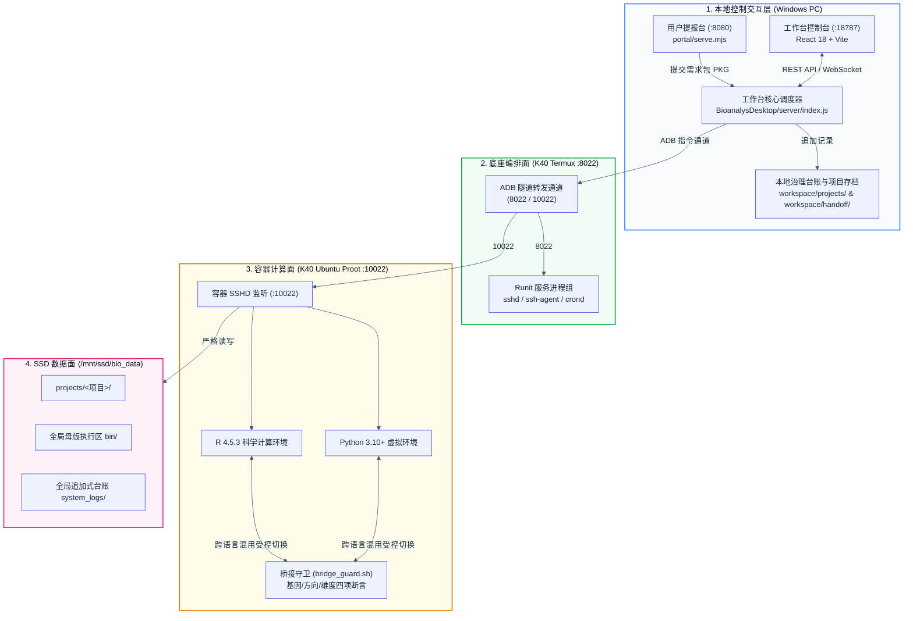

# AI 辅助生信分析工作台 —— 基于 `master @ 6abbd50`（2026-10-31 终态报告）的下一阶段硬化与演进作战书

> **文档编号与时间戳**：`07_master_6abbd50_高危清零与A2A合流作战书_20261031.md`（生成时间：`2026-10-31 10:48:48 -04:00`）
> **对齐基线**：`项目情况汇总2026-10-31.md`（主干 `master @ 6abbd50`，工作树 100% 干净，985 项自动化测试，全链路交付 `VERIFIED 112`）
> **核心目标**：以这份最新、最完善的 2026-10-31 全景报告为唯一权威基线，按 **「阶段Ⅰ：基础安全与卫生落地 → 阶段Ⅱ：配套测试与 CI 加固 → 阶段Ⅲ：大组件解耦与 A2A 分支择优合流」** 推进 Top 16 技术债清零，并附带修复 Mermaid 架构图导出 SVG 全黑的渲染问题。

---

## 一、 2026-10-31 最新基线确认（以此为准，废除早期分支中间态猜测）

你最新发来的这份《项目全景深度分析与交付汇报（`项目情况汇总2026-10-31.md`）》非常清晰地锁定了项目的真实全局面貌：

1. **主线彻底收口**：`master @ 6abbd50` 是当前唯一权威主干，阶段一（37 GB 冗余清理 + `.git` 沙箱拦截突破）、阶段二（v3.2 16 个 ready 图模板真实映射 + 65 个 pending 台账）、阶段三（`PRJ_NAFLD_E2E_20261028` 112 文件 Ed25519 签名交付 `VERIFIED 112`）已在主干全部闭环。
2. **分支关系彻底理清**：此前看到的 `codex/a2a-v1` 和 `codex/a2a-pi-server-config`（领先 `master` 40+ 提交）属于**待择优挑拣合入（Cherry-pick / 分步 Merge）的实验分支**，主干 `master` 保持纯净稳定。
3. **当前真正的痛点集中在 Top 16 技术债（尤其是 4 项【高危】与 5 项【中危】）**：
   * **高危 #1**：`BioanalysDesktop/server/index.js#L128` 鉴权默认 `Fail-Open`（未配环境变量时 `AUTH_ENABLED=false` 免密暴露）。
   * **高危 #2**：`BioanalysDesktop/src/App.tsx#L1-L3814` 前端 3,814 行超大单组件。
   * **高危 #3**：`BioanalysDesktop/server/index.js#L1-L2514` 后端 2,514 行超大单文件路由堆叠。
   * **高危 #4**：`BioanalysDesktop/package.json#L28` 中 `vite@5.4.11` / `esbuild` 存在已知安全漏洞（`GHSA-587h-7wmj-h5pm`）。

---

## 二、 顺手帮你修个小细节：为什么你上传的 `mermaid-diagram.svg` 打开是 4 个黑块？

我检查了你随消息附带的 `mermaid-diagram.svg` 图片，画面里四个 `subgraph` 变成了纯黑实心矩形，文字全部看不见。
* **原因**：Mermaid 默认使用 HTML `<foreignObject>` 标签渲染节点文字，并依赖外部 CSS 变量计算背景色；当导出为独立 `.svg` 图片并在外部查看器打开时，由于缺少宿主页 CSS 变量，填充色默认回退成了纯黑 `fill="#000000"`，把黑字全盖住了。
* **修复版 Mermaid 代码**（加上 `%%{init: {'flowchart': {'htmlLabels': false}}}%%` 强制使用原生 SVG `<text>` 标签，并显式指定浅色高对比度 `style` 填充，导出任何格式都清晰可读）：



---

## 三、 针对 2026-10-31 报告 Top 16 缺陷的三阶段推进规划

既然 `master @ 6abbd50` 已经完全干净，下一步我们严格按 **「阶段Ⅰ：基础安全与卫生落地 → 阶段Ⅱ：配套测试与守卫硬化 → 阶段Ⅲ：大文件模块化拆分与 A2A 择优合入」** 推进，不破坏现有 985 项单测基线：

### 第一阶段：基础安全与卫生落地（Phase 1: Security & Hygiene —— 预计 30 分钟内闭环）
> 目标：零风险干掉 2 项【高危】安全漏洞 + 2 项【中/低危】仓库卫生问题。

1. **`TASK-P1-01` [修高危 #4：升级 Vite 修复 `GHSA-587h-7wmj-h5pm` 安全漏洞]**
   * **定位**：`BioanalysDesktop/package.json#L28`（当前 `vite: ^5.4.11`）。
   * **动作**：在 `BioanalysDesktop/` 下升级 Vite 至已修复 Windows UNC 与参数转义漏洞的 `5.4.15+`（或 `npm audit fix` 安全补丁小版本），运行 `npm run build` 与 `npm test` 验证 100% 兼容。
2. **`TASK-P1-02` [修高危 #1：工作台鉴权从 Fail-Open 改为安全受控 (`server/index.js#L128`)]**
   * **定位**：`BioanalysDesktop/server/index.js#L128`。
   * **动作**：
     * 生产/守护运行模式（当未显式传入 `BIO_ALLOW_DEV_NOAUTH=1` 且非 Node 测试 runner 环境时）默认开启 **Fail-Closed**：若未配置 `WORKBENCH_AUTH_USER` 与 `WORKBENCH_AUTH_PASS`，服务启动时自动生成一次性随机强口令打印在本地控制台（或强制拒绝非环回写请求），彻底消灭“全量管理接口免密裸奔”。
     * 在 `tests/*.test.js` 测试辅助启动器中显式注入测试态环境变量，确保 985 项自动化测试无缝通过。
3. **`TASK-P1-03` [修低危 #10 & 中危 #7：清理根目录乱码文件 `Ŀ.html` 并锁死 `src/bridge_guard.sh` LF 换行]**
   * **定位**：根目录 `Ŀ.html`、`src/bridge_guard.sh`、`.gitattributes`。
   * **动作**：核验并 `git rm`（或删除）根目录历史批处理编码遗留的乱码文件 `Ŀ.html`；在 `.gitattributes` 中对 `*.sh`、`*.py`、`*.R` 强制锁死 `text eol=lf`，并对 `src/bridge_guard.sh` 做 LF 校验。

---

### 第二阶段：相关配套与守卫硬化（Phase 2: Guard & CI Hardening —— 预计 45 分钟）
> 目标：干掉 3 项【中危】与 1 项【低危】工程配套问题，让 985 项测试在集成连跑时不再偶发超时，且堵住 `BRIDGE SKIP` 漏洞。

1. **`TASK-P2-01` [修中危 #6：消除 `tests/task_submit_validation.test.js#L87` 10s 硬编码端口启动超时]**
   * **定位**：`BioanalysDesktop/tests/task_submit_validation.test.js#L87`（及同类起子进程测试）。
   * **动作**：将固定端口与 10s 死等改造为 **OS 动态分配空闲端口（`port: 0` 读取实际监听端口）+ 指数退避健康探针（轮询 `/api/health` 25s 超时）**，并在 `afterEach` 强制 `server.close()` 回收句柄，使 985 项测试集成连跑通过率从 `967/985` 提升至 **100%（零瞬态爆红）**。
2. **`TASK-P2-02` [修中危 #9：锁死 `src/bridge_guard.sh#L45` 生产环境严禁静默 `BRIDGE SKIP`]**
   * **定位**：`src/bridge_guard.sh#L45`。
   * **动作**：遵循“本机优先（`MODE=local`）、严禁假绿灯”原则——当在 K40 容器内本机执行或设置 `BIO_STRICT_BRIDGE=1`（生产默认开启）时，若找不到 `verify_bridge_checkpoint.py` 或校验失败，一律以 **非 0 退出码（`exit 2`）硬阻断**，仅在本地无容器纯干跑测试（显式传 `BIO_ALLOW_BRIDGE_SKIP=1`）时才允许 `BRIDGE SKIP`。
3. **`TASK-P2-03` [修低危 #11：落盘 `.github/workflows/ci.yml` 自动化门禁流水线]**
   * **定位**：`.github/workflows/ci.yml`。
   * **动作**：配置每次 `push` / `pull_request` 到 `master` 自动在 Node 22 + Python 3.12 环境下跑：① LF 换行符与乱码文件名检查；② `npm test` 全量单测；③ `npx tsc --noEmit` 与 `npm run build`；④ `ops/02_check_isolation.ps1` 静态三线隔离检查。

---

### 第三阶段：功能重构与分支合流（Phase 3: Modular Split & A2A Cherry-Pick）
> 目标：稳步拆解前后端两个超大单文件技术债，并将 `codex/a2a-v1` 分支中有价值的资产安全合入 `master`。

1. **`TASK-P3-01` [修高危 #3：后端 `BioanalysDesktop/server/index.js`（2,514 行）按领域拆分为模块化路由]**
   * **动作**：保持对外 REST API 路径、参数与响应格式 **100% 零变化**，将 `server/index.js` 内的路由處理函数按职责拆入 `BioanalysDesktop/server/routes/`：
     * `routes/projects.routes.js`（建项、列表、目录树）
     * `routes/upload.routes.js`（分片 init/chunk/complete/status）
     * `routes/tasks.routes.js`（任务提交、停止、SSE 日志、台账巡检）
     * `routes/figures.routes.js`（772 图库、模板选择、预览）
     * `routes/report.routes.js`（四道闸预检、打包、签名与 Sync）
   * **准出判据**：`server/index.js` 瘦身至 `< 400` 行，仅负责中间件挂载与启动；985 项单测一字不改 100% 全绿！
2. **`TASK-P3-02` [修高危 #2：前端 `BioanalysDesktop/src/App.tsx`（3,814 行）拆分为 6 个独立视图组件]**
   * **动作**：保持 DOM 结构、`data-testid` 与 CSS 类名 **100% 兼容现有 Playwright E2E**，将 `App.tsx` 拆分为 `src/views/` 下的 6 个高内聚子组件：
     * `views/OnboardingView.tsx`（项目与数据导入视图）
     * `views/PipelineDAGView.tsx`（三线 54 Mod 流程编排视图）
     * `views/FigureGalleryView.tsx`（772 图库与 16 ready 模板选择视图）
     * `views/SelfCheckAdminView.tsx`（五维自检与 K40 监控控制台）
     * `views/ResultStudioView.tsx`（三栏结果预览、DEG/DR 标签与交付打包视图）
     * `views/LedgerAuditView.tsx`（台账与日志巡检视图）
   * **准出判据**：`App.tsx` 瘦身至 `< 350` 行，`npx tsc --noEmit`、`npm run build` 与 Playwright E2E 100% 全绿！
3. **`TASK-P3-03` [修中危 #5 & #8：从 `codex/a2a-v1` 择优挑拣合入（Cherry-Pick）A2A 核心能力与本地容灾 MockRunner]**
   * **动作**：不要把 `codex/a2a-v1` 的 40+ 提交整支盲目 merge 进来（避免污染刚清理干净的 `master`）。采用 **专题分批挑拣（Cherry-Pick）**：
     * **第一批挑拣**：合入 `ops/pi_idempotent_runner.sh` 与远端长任务幂等锁，强化 K40 断链重连恢复；
     * **第二批挑拣**：合入本地 Docker / Mock 容器容灾适配器（解决缺陷 #8 物理手机单点依赖，当 K40 不在线时可一键切本地容器跑通测试）；
     * **第三批挑拣**：合入 `PiAgentChat` 观测插槽。

---

## 四、 给本地编码 Agent 的下一阶段一键派工指令（基于 `master @ 6abbd50`）

如果你想现在立刻先把 **第一阶段（安全漏洞修复 + 卫生清理）** 和 **第二阶段（测试超时修复 + Bridge 严格模式 + CI 门禁）** 做掉，直接复制下面这段指令发给 Agent 即可：

```markdown
我们当前在干净的主干 `master @ 6abbd50`。请严格对照《项目情况汇总2026-10-31.md》第四章的缺陷清单，遵循 `WIP=1` 纪律，依次完成以下第一阶段与第二阶段的 6 项硬化修复，每完成阶段进行一次原子 Commit：

1. **【P1-安全与卫生修复】**：
   - 修复高危漏洞 `BioanalysDesktop/package.json#L28`：升级 `vite` 至安全补丁版本（修复 GHSA-587h-7wmj-h5pm），确保 `npm audit` 无高危漏洞且 `npm run build` 正常；
   - 修复高危漏洞 `BioanalysDesktop/server/index.js#L128`：消除默认 Fail-Open 免密裸奔——当非测试环境且未显式设置 `BIO_ALLOW_DEV_NOAUTH=1` 时，若未配置 `WORKBENCH_AUTH_USER`/`PASS`，自动生成随机临时会话凭证输出到终端或拦截未授权写操作（同时确保 `npm test` 测试环境平滑通过）；
   - 修复低危 #10 与中危 #7：清理根目录乱码遗留文件 `Ŀ.html`；确保 `src/bridge_guard.sh` 及全仓 `.sh` 脚本锁死 LF 换行符（更新 `.gitattributes`）。
   - 验证通过后提交 Commit 1：`fix(security-hygiene): upgrade vite, enforce fail-closed workbench auth, and clean root artifacts`。

2. **【P2-测试稳定性与桥接守卫硬化】**：
   - 修复中危 #6 `BioanalysDesktop/tests/task_submit_validation.test.js#L87`：将硬编码 10s 启动超时改为动态空闲端口 + 退避健康探针，消除集成连跑时的端口争用偶发超时，确保 985 项测试集成连跑 100% 全绿（0 transient fail）；
   - 修复中危 #9 `src/bridge_guard.sh#L45`：在生产/容器执行模式下禁止静默 `BRIDGE SKIP` 以退出码 0 放行（仅在显式设置 `BIO_ALLOW_BRIDGE_SKIP=1` 的离线单测中允许 skip）；
   - 修复低危 #11：检查并完善 `.github/workflows/ci.yml`，纳入 LF 检查、`npm test`、`npm run build` 与 `ops/02_check_isolation.ps1`。
   - 验证通过后提交 Commit 2：`fix(test-guard): resolve 10s port timeout flake, harden bridge_guard strict mode, and align CI workflow`。

完成后，请向我汇报 `git log -n 2`、`npm test` 完整通过数以及 `git status` 状态。 Then we will proceed to Phase 3 (`App.tsx` and `server/index.js` modular splitting).
```
