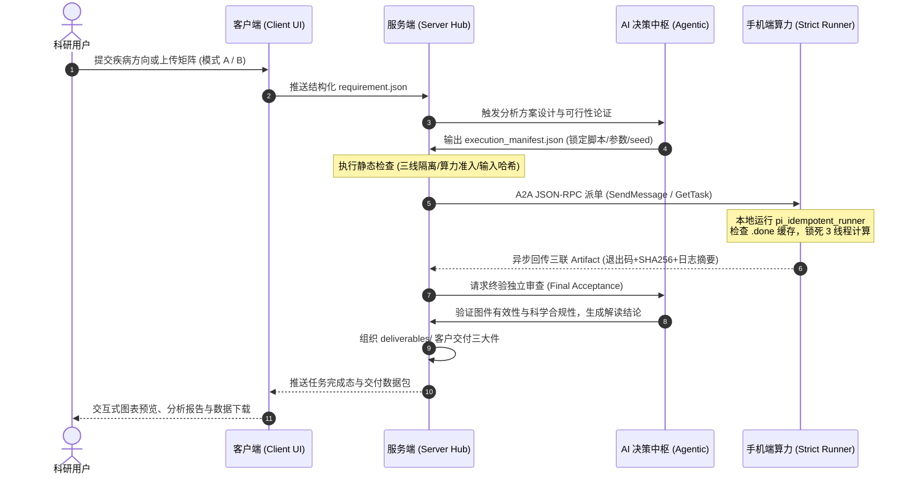

# 分布式 AI 生信分析自动化工作台：四大板块架构演进与全流程数据交互方案

> **文件属性**：架构演进与专家汇报方案（Executive Briefing Document）  
> **工程基准**：基于当前工作台 v1.1.0 资产、三线物理隔离约束与 A2A v1.0 协议规范  
> **核心命题**：手机边缘算力改造 + 客户端交互 + 服务端调度 + AI 全流程自动化的四维闭环体系  

---

## 一、 汇报摘要（Executive Summary）

本项目致力于解决传统生物信息学分析中**算力门槛高昂、流程碎片化、跨端交互脆弱、AI 仅能充当局部代码生成助手而无法端到端闭环**的行业痛点。

本次汇报提出的核心方案是：将工作台系统重构升级为**四大高度内聚、单向依赖的独立标准板块**：
1. **手机端算力栈（Mobile Compute Node）**：将消费级移动设备转化为高可用、轻量化、具备自我防护的边缘生信算力服务器。
2. **客户端交互界面（Client Intake & UI）**：提供标准化生信科研需求采集、课题准入初筛与高维数据可视化交互面板。
3. **服务端控制中枢（Server & Orchestration Hub）**：承担生命周期管理、任务切块、三线物理隔离断言、产物对账与交付物打包。
4. **AI 全流程辅助系统（AI-Native Agentic Automation）**：作为全流程中枢大脑，以“AI 可读可操控”为大前提，驱动端到端数据流动、智能容错与双阶段终验。

每个板块均严格继承现存工程已验证的 **1 + N×3 文档驱动工程规范**（含最高纲领、阶段总目标、瞬态工序流、持久态落地底座、QA/TDD 回归测试套件）及专属的 **Reference 知识库架构**，通过严格的单向数据流与传算分离机制，构建起工业级稳定的生信自动化流水线。

---

## 二、 现有工程基线与资产盘点（Current Reality）

当前工作台已经经过数轮迭代，沉淀了大量可直接复用、且经过生产级验证的技术底座：

| 维度 | 现存技术资产与物理载体 | 已解决的核心问题与工程意义 |
| :--- | :--- | :--- |
| **生信分析与数据隔离** | • 三线物理隔离（`docs/isolation.md`：`line1_bulk`、`line2_scrna`、`line3_spatial`）<br>• 单细胞与空间转录组虚拟敲除（scTenifoldKnk）<br>• 目录规范（`docs/directories.md`） | 根治多组学分析交叉污染、跨线偷跑参考集的问题，确立数据与脚本严格物理隔离。 |
| **移动端算力与物理保活** | • Redmi K40（高通骁龙 870，8/12GB 物理内存）<br>• Termux 原生分区 + `k40-ubuntu` 容器环境<br>• `ops/bio_limits.sh` 算力约束（锁死 3 线程，设定内存熔断阈值）<br>• Android 保活机制（WakeLock、电池无限制策略、Phantom 进程抑制） | 验证了在移动边缘设备上稳定运行 R、Bioconductor、Python/Scanpy 等重型生信计算的可行性。 |
| **分布式通信与任务自治** | • A2A 协议底座（Linux Foundation A2A v1.0，JSON-RPC 2.0）<br>• Tailscale Mesh 专网直连（`100.64.0.0/10`，强制 `NO_PROXY` 绕过本地代理）<br>• 幂等防重跑执行器（`ops/pi_idempotent_runner.sh`，原子 `.lock`/`.done` 检查点） | 攻克网络闪断引发的整步重跑痛点，实现断网手机本地自治计算、联网秒级续领产物。 |
| **交互与服务原型** | • `portal/`：模式 A 课题调研输入与需求单生成（`requirement.json`）<br>• `BioanalysDesktop/`（`127.0.0.1:18787`）：前端桌面交互与后端 API 路由<br>• 自动化打包（`deliverables/` 客户三大件组织器） | 具备生信科研需求结构化采集、中间图件呈现与最终交付物输出的链路雏形。 |
| **AI 决策与规范体系** | • 课题准入筛子（`docs/topic_sieve_spec.md`：L0~L4、T1~T9 硬性指标）<br>• Agent 调研技能（`.agents/skills/topic-survey`）<br>• 双层五类追加式 JSONL 治理台账（`con_hf/ledger/*.jsonl`） | 保证 AI 在做课题规划与数据筛选时具备可落地的硬规则边界，杜绝盲目幻觉。 |

---

## 三、 四大板块划分与现存架构映射（Architecture Mapping）

针对新设想的 4 个板块，我们将其与现存架构资产做精准映射，并为每个板块确立与 `aims/A2A` 同构的 **1 + N×3 文档规范** 和 **Reference 知识库**：

```
AI 辅助生信分析流程工作台
│
├── 01_mobile_compute/       【板块一：手机端算力栈】
│   ├── aims/               (00_最高纲领 / 01_总目标 / 02_工序清单 / 03_落地底座 / 04_QA测试)
│   ├── reference/          (ARM64编译包 / 容器优化 / 低功耗策略 / 工具内存压测基线)
│   └── runtime/            (k40-ubuntu / bio_limits / pi_idempotent_runner / telemetry)
│
├── 02_client_ui/           【板块二：客户端交互界面】
│   ├── aims/               (00_最高纲领 / 01_总目标 / 02_工序清单 / 03_落地底座 / 04_QA测试)
│   ├── reference/          (表单交互规范 / 可视化出图标准 / 样本元数据Schema)
│   └── src/                (portal门禁 / Web交互面板 / 图表渲染引擎 / 断点续传前端)
│
├── 03_server_orchestrator/ 【板块三：服务端控制中枢】
│   ├── aims/               (00_最高纲领 / 01_总目标 / 02_工序清单 / 03_落地底座 / 04_QA测试)
│   ├── reference/          (分布式调度策略 / 隔离校验算法 / 交付打包标准 / 对账协议)
│   └── core/               (任务分发状态机 / 隔离拦截守卫 / 产物三联包归集 / JSONL台账引擎)
│
└── 04_ai_automation/       【板块四：AI全流程辅助】
    ├── aims/               (00_最高纲领 / 01_总目标 / 02_工序清单 / 03_落地底座 / 04_QA测试)
    ├── reference/          (课题设计知识库 / 故障自愈Prompt库 / 优质生信管线代码参考)
    └── agents/             (课题调研Agent / 管线编排Agent / 质量终验Agent / A2A通信适配)
```

### 各板块详细定义与边界规格

#### 1. 手机端算力栈（Mobile Compute Node）
* **定位**：去中心化、物理自治的纯计算执行节点（Strict Runner 模式）。
* **对应现存资产**：Redmi K40、`ops/bio_limits.sh`、`ops/pi_idempotent_runner.sh`、`pi_telemetry_sidecar.py`。
* **aims 核心契约**：
  * **00_纲领**：锁死原生 `ext4` 分区，严禁写入 `/sdcard`；严格只读挂载母版代码，严禁私自修改源码与种子（`seed=20261013`）。
  * **01_总目标**：定义 ARM64 环境下 R 4.3+/Python 3.10+ 生信包支持清单；确立最大并发数（`maxConcurrent: 2`）与默认 3 线程约束。
  * **02_工序**：Termux 自动化加固、Ubuntu 容器构建、保活五件套部署。
  * **03_落地**：自愈巡检脚本、进程组退出回收（`setsid`）、日志重定向削峰规范。
  * **04_QA**：断电恢复测试、内存满载熔断测试、单步耗时与 SHA256 吻合度回归。
* **reference 内容**：ARM64 架构预编译 Wheel/Deb 包索引、低功耗散热参数、生信工具在 ARM64 上的内存压测表。

#### 2. 客户端交互界面（Client Intake & UI）
* **定位**：面向科研用户的意图输入端口与成果消费终端。
* **对应现存资产**：`portal/`、`BioanalysDesktop/src/`、需求结构化模板。
* **aims 核心契约**：
  * **00_纲领**：强 Schema 校验门禁，零非法字符与破损格式入库；无直连手机算力端后门。
  * **01_总目标**：实现模式 A（课题方向反推）与模式 B（自备数据分析）的标准表单输入，生成自描述的 `requirement.json`；支持 GB 级数据分片校验与断点续传。
  * **02_工序**：输入组件化拆解、图表交互联动、交付物在线预览开发。
  * **03_落地**：前端路由规范、SSE 任务进度长连接接入、交互态异常捕获。
  * **04_QA**：表单极值注入测试、网络重连恢复测试、UI 跨端适配验证。
* **reference 内容**：GEO/临床样本临床信息（Metadata）标准模板、医学期刊出图配色与版式标准、UI/UX 交互规范。

#### 3. 服务端控制中枢（Server & Orchestration Hub）
* **定位**：全系统的总调度器、质量守卫与交付物制造中心。
* **对应现存资产**：`BioanalysDesktop/server/`、`con_hf/ledger/`、`ops/02_check_isolation.ps1`。
* **aims 核心契约**：
  * **00_纲领**：三线隔离绝对物理阻断；单真源台账管理（JSONL）；所有对外通信锁定 Tailscale 隧道与 Token 鉴权。
  * **01_总目标**：任务切块为 DAG 有向无环图；维护双模状态机（同步 SendMessage 与异步 GetTask 轮询）；校验并落库算力端回传的结构化三联 Artifact（JSON + Diff + SHA256）；产出 `deliverables/` 客户三大件。
  * **02_工序**：A2A 客户端集成、三线运行时路径断言守卫装配、台账汇总索引器落地。
  * **03_落地**：生产级调度服务配置、大文件本地化存储规范、Token 与敏感信息打码机制。
  * **04_QA**：任务超时孤儿回收测试、跨项目目录越界访问拦截测试、哈希冲突对账测试。
* **reference 内容**：分布式流水线调度算法参考、工业级数据去重与校验规范、审计日志法规合规要求。

#### 4. AI 全流程辅助系统（AI-Native Agentic Automation）
* **定位**：全链路的认知决策引擎，保证全流程对 AI 开放、可读、可测、可控。
* **对应现存资产**：`aims/A2A` 协议、`docs/topic_sieve_spec.md`、`.agents/skills/topic-survey`。
* **aims 核心契约**：
  * **00_纲领**：查事实是 AI 的职责，做决策是用户的职责；结构化输出优先于口语化输出；执行异常遵循先建红反馈环再修代码原则。
  * **01_总目标**：模式 A 自动外挂 GEO 检索与多维筛子过滤；自动根据需求单合成分析管线脚本；分析报错时自动读取削峰日志并自愈修复；执行严格的两阶段验收（初步验收与独立终验）。
  * **02_工序**：Prompt 模板解耦、Tool-calling 权限沙箱化、端到端自动化验证。
  * **03_落地**：Agent 路由配置、知识库检索挂载、多模型白名单热切换支持。
  * **04_QA**：课题筛选准入准确率测试、代码生成一次运行通过率测试、模型漂移检测。
* **reference 内容**：经典生信流水线设计范例（Bulk、scRNA、Spatial）、历史常见报错与自愈案例集（Pitfalls）、提示词工程基准。

---

## 四、 端到端数据流闭环：客户端 - 服务端 - 算力端（Data Interaction Pipeline）

全系统以**数据只跑必要路径、算力本地消化、控制流绝对受控**为原则，形成以下数据传递闭环：



### 数据交互链的三项核心保障：
1. **传算解耦**：
   公共参考库（如基因组注释、单细胞参考层）持久化常驻手机本地；网络间绝不大规模传输原始大文件，仅传输轻量化表达矩阵（TSV/H5AD）与三联 Artifact（控制在 4MB 以内）。
2. **状态透明可溯**：
   从客户端需求到最终交付包，每个环节均在服务端生成带时间戳、任务哈希与操作人员标记的双层追加式 JSONL 台账，AI 与审计人员随时可无死角复盘。
3. **断链绝对免疫**：
   派发给手机端的任务均由独立进程组托管；手机掉线、熄屏或 Wi-Fi 抖动完全不影响计算推进；网络重连后服务端通过 `GetTask` 秒级领回结果，杜绝重复计算。

---

## 五、 方案可行性评估与创新价值总结

向专家汇报时，本方案展现出三大维度的降本增效与学术工程价值：

### 1. 硬件成本颠覆：闲置移动终端的边缘算力升格
传统生信高度依赖昂贵的高性能服务器或按量计费的公有云。通过引入轻量化容器、ARM64 编译优化、严格 3 线程与内存保护机制，成功将数百元至千元级的闲置骁龙手机（如 K40）打造成专用的多组学计算节点。既自带电池防断电，又具备极高能效比，为轻量生信分析提供了极低门槛的算力方案。

### 2. 软件工程严密：根治网络抖动与生信数据污染
引入微内核插座架构、A2A v1.0 协议以及基于文件锁的幂等执行器，将分布式系统中最棘手的断网、进程被杀、重复提交问题在边缘层彻底消化。同时，硬性实施三线物理隔离，确保科研数据之间不交叉、外部验证集不偷跑，保障学术产出的真实性与复现性。

### 3. AI 深度融合：从代码片段生成跃升为自治系统编排
系统不再把大模型当作单纯的聊天框，而是将其作为贯穿 Client - Server - Compute 的系统大脑。所有接口设计均以“机器可读”为前提，AI 能够通过强契约的 JSON-RPC 和 Schema 自主完成“需求理解 -> 课题设计 -> 任务派发 -> 监控诊断 -> 质量终验”的全流程自动化，真正实现端到端 Agentic 工作台。

---

## 六、 供专家研讨的核心议题（Discussion Topics with the Expert）

在交流中，建议重点向专家请教以下四个高阶架构设计点：

1. **生信算法在 ARM64 边缘节点的算力边界（Compute Sieve）**：
   目前已成功跑通标准 Bulk 差异分析、WGCNA 与中小型单细胞质控聚类。针对大样本量单细胞轨迹分析或空间解卷积等超大内存任务，专家建议采取怎样的自适应分块或降采样裁剪策略？
2. **两阶段验收中 AI 终验判据的量化评估（Validation Harness）**：
   目前系统通过退出码、PNG 头部魔数与尾部 IEND、SHA256 吻合度进行机器核验。在生物学意义层面（如标记基因特异性、批次效应消除程度），专家对于构建自动化评分卡（Scorecard）有何见解？
3. **四板块间的演进时序与解耦颗粒度**：
   在推进 1 + N×3 文档与代码切块时，是否优先将“手机算力端标准镜像”与“服务端调度微内核”独立打磨为两个可单独交付的开源构件？
4. **多设备边缘计算集群横向扩展的可能性**：
   当前架构已实现单台手机算力节点的高可用自治。若未来接入 3~5 台同类设备形成局域网边缘算力池，服务端的任务调度器在负载均衡和动态选主上有哪些成熟的最佳实践可供参考？
