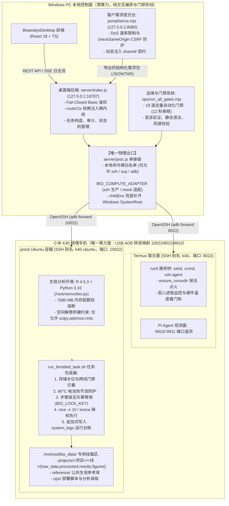

# 分册 01 · 全仓架构与目录全景 (Architecture & Workspace Overview)

> **文档性质**：系统物理拓扑、分层依赖、关键接缝与目录职责规范正本  
> **基线版本**：2026-11-07  

---

## 一、物理拓扑与分层架构

系统严格遵循**“交互控制面（PC）与算力计算面（手机容器）”物理隔离**与**“三线流水线物理隔离”**的双重隔离架构：



---

## 二、核心端口矩阵与通信协议

| 服务 / 进程 | 默认端口 | 监听地址 | 通信协议 | 凭据与安全机制 | 说明 |
|---|---|---|---|---|---|
| **BioanalysDesktop 后端** | `18787` | `127.0.0.1` | HTTP / SSE | Fail-Closed Basic Auth (`BAD_USER`/`BAD_PASS`) | 管理员编排与任务监控后端；未授权一律 401 |
| **BioanalysDesktop 前端** | `5173` | `127.0.0.1` | HTTP | 本地直接访问 | Vite React 18 SPA 单页交互应用 |
| **Portal 客户需求门户** | `8080` | `127.0.0.1` | HTTP | 动态 CSRF 校验 + 速率限制 | 客户需求表单填报与分块上传服务 |
| **K40 容器 SSH (执行面)** | `10022` | `127.0.0.1` (经 adb) | SSH 2.0 | Ed25519 密钥对 (`~/.ssh/id_ed25519`) | `k40-ubuntu` 别名，高负载生信分析执行入口 |
| **K40 宿主 SSH (管理面)** | `8022` | `127.0.0.1` (经 adb) | SSH 2.0 | Ed25519 密钥对 | `k40` 别名，Termux 宿主维护与服务树看门狗 |
| **Pi Agent 遥测通道** | `9910` / `9911` | `127.0.0.1` (经 adb) | HTTP / WS | 隧道透传 | 运行期观测与状态遥测插槽 |

---

## 三、模块划分与单向依赖方向

全仓代码严格坚持**单向无环依赖**与**分层关注点隔离**：

```text
[前端 React 视图] ──────────► [REST API / SSE 长连接] ──────────► [后端 index.js 路由]
                                                                      │
                                                                      ▼
[公共契约 shared/] ◄────────── [依赖注入 routeCtx] ───────────► [业务子路由 routes/*]
                                                                      │
                                                                      ▼
                                                            [核心引擎 run.js / task.js]
                                                                      │
                                                                      ▼
                                                            [审计防线 server/audit.js]
                                                                      │
                                                                      ▼
                                                            【唯一接缝】server/proc.js
                                                                      │
                                                                      ▼
                                                            [系统白名单: ssh/scp/adb]
```

1. **前端与后端完全解耦**：前端 `BioanalysDesktop/src/views/` 严禁直接引用后端代码或本地文件系统，全部交互通过 HTTP 请求和 SSE 协议；共享常量通过 `server/domain.js` 与 `shared/` 提供。
2. **后端微内核依赖注入**：`server/index.js` 统一装配 `routeCtx` 上下文对象（内含进程接缝句柄、远端执行器、审计器、路径常量等），按需注入至 `server/routes/*.routes.js`（`projects`, `tasks`, `figures`, `upload`, `report`, `diagnostics`）。子路由之间零横向依赖。
3. **本地程序执行单接缝（`server/proc.js`）**：本地操作系统命令执行的唯一咽喉。白名单仅放行 `ssh`、`scp`、`adb`，禁止调用原生 bash/Python/R，并统一注入 `childEnv` 补齐 Windows 系统环境变量，杜绝 OpenSSH 255 崩溃。
4. **双端共享契约唯一真源（`shared/`）**：`data_formats.mjs` 与 `requirement_schema.mjs` 为 Portal 端与 Admin 端共享的单一事实源。Portal 启动时通过动态代码注入挂载至浏览器环境，消灭前端与后端规则漂移。

---

## 四、全仓目录树与职责说明

```text
AI辅助生信分析流程工作台/
├── AGENTS.md                  # Agent 入职纪律、导航指针、编码禁忌（强制每轮载入）
├── docs/                      # 18 份工程与生信规范正本（唯一真源）
│   ├── SCOPE.md               #   范围界定与 11 项 REJ 已否决设计账本（绑定自动化门禁）
│   ├── isolation.md           #   三线物理与数据隔离红线规范（最高优先级规则）
│   ├── coding-standards.md    #   Linux 面编码规范、seed 随机种子契约、退出码标准
│   ├── directories.md         #   全仓目录规划与文件落点真本
│   ├── figure_spec.md         #   SCI 级出图排版、300 DPI、色彩空间与 Visium 晶格标定标准
│   ├── topic_sieve_spec.md    #   课题准入漏斗（L0-L4 过滤器与 T1-T9 判定标准）
│   └── software_versions.json #   算力面 R/Python 包固定版本记录
├── src/                       # 三线生信分析脚本母版（Linux 运行面，一步一脚本，无扩展名）
│   ├── line1_bulk/scripts/    #   15 个 Bulk 转录组分析母版（prep_matrix, deg_limma, wgcna...）
│   ├── line2_scrna/scripts/   #   22 个单细胞转录组母版（harmony, virtual_knockout, scenic...）
│   ├── line3_spatial/scripts/ #   17 个空间转录组母版（ingest_spatial, spatial_domains, figures...）
│   ├── workflows.json         #   3 系列 49 个 Mod 步骤编排正本（输入输出契约、资源配额）
│   └── figure_templates.json  #   82 个 SCI 图件模板注册表（30 ready 封板模板逐图 sha256 核验）
├── BioanalysDesktop/          # 本地管理端工作台（控制面）
│   ├── server/                #   Node.js 原生 HTTP 微内核后端
│   │   ├── index.js           #     入口主服务（端口 18787，Fail-Closed 鉴权）
│   │   ├── proc.js            #     【关键接缝】本地子进程唯一出口（仅白名单程序）
│   │   ├── audit.js           #     跨线越界命令审计拦截器
│   │   ├── run.js             #     任务派发与日志流转引擎
│   │   └── routes/            #     拆分后的业务子路由模块
│   ├── src/                   #   React 18 + Vite 前端界面
│   │   ├── App.tsx            #     主页面外壳与 Tab 状态机
│   │   └── views/             #     6 大主视图（Onboarding, Gallery, SelfCheck 等）
│   ├── tests/                 #   212 个 node:test 测试套件（1823 个测试用例，全绿覆盖）
│   └── README.md              #   工作台使用指南与最新实测基线
├── portal/                    # 客户需求提交门户（轻量独立服务，端口 8080）
│   ├── serve.mjs              #   原生 HTTP 需求提交后端（DoS 与 CSRF 防护）
│   └── index.html             #   单页提交前端（差异档位配置、肿瘤黑名单拦截、分块上传）
├── shared/                    # 跨端唯一真源（前端、后端、门户共享纯函数）
│   ├── data_formats.mjs       #   输入数据格式白名单与大小上限
│   ├── requirement_schema.mjs #   客户需求单强类型校验器（手写中文诊断）
│   └── upload_session.mjs     #   分块断点续传状态机
├── ops/                       # 运维、测试与质量门禁工程正门
│   ├── run_all_gates.mjs      #   【总门禁】19 道串联总门禁核心入口（本地与 CI 同构）
│   ├── router.yaml            #   12 条声明式场景路由表（意图 -> 线/Mod/约束）
│   ├── router_gate.mjs        #   路由真实性与 SCOPE.md 门禁绑定静态校验
│   ├── static_gate.mjs        #   四语种静态语法门禁（PS1/Shell/Python/R）
│   ├── mutation_gate.mjs      #   变异门禁（7 条防线反证，遇破坏必红）
│   ├── k40_script_parity.mjs  #   K40 设备 57 母版脚本逐字节同源校验器
│   ├── spatial_calibration.py #   空间切片物理晶格标定唯一算法模块
│   ├── figure_scalebar_png_measure.py # 独立 PNG 像素端刻度间距测量核验工具
│   ├── report_render_html.py  #   综合分析报告静态 HTML 渲染引擎（带脱敏过滤）
│   └── run_throttled_task.sh  #   算力面任务执行包装器（门禁、90°C热节流、幂等互斥锁）
├── local_projects/            # 实际业务分析项目产物区
│   ├── PRJ_STROKE_P1_SPATIAL_ABCA1/       # 卒中线粒体能量-脂质代谢空间转录组项目
│   └── PRJ_STROKE_P2_SPATIAL_LACTPYRO_5GENES/ # 卒中乳酸化-焦亡空间转录组项目
├── 可用代码预筛选/            # 【非生产代码归档区】历史 3,000+ 参考代码独立存放（零污染）
│   ├── 功能-出图对应索引表.md  #   51 KB 详尽功能与出图对应全景索引
│   └── 可用/                  #   按三线隔离归档的参考 R/Python 脚本与指南
├── con_hf/                    # 治理与交接台账区
│   ├── handoff.md             #   跨轮次技术交接与演进历史链
│   └── ledger/actions.jsonl   #   追加式不可变动作台账
└── 交接清单/                  # 【本交接总卷】系统性全量技术交付与交接手册目录
```
