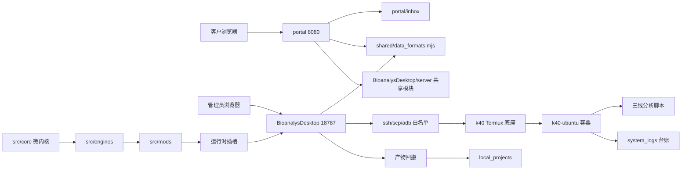

# 项目情况汇总

> 生成时间：2026-10-30 00:17（Asia/Shanghai）
> 生成方式：只读分析本仓库，不修改业务代码。本文档为新增交付物。
> 分析基线：当前工作区（含未提交改动），并同时对照已提交历史与验证报告。
> 当前分支：`codex/a2a-v1`，最新提交 `e3551d2`，领先 `origin/codex/a2a-v1` 30 个提交。
> 注意：无 `.env`、密钥或口令明文写入本文。示例中的敏感值一律以 `<REDACTED>` 表示。

## 一、项目概况

### 1.1 项目名称与用途

项目是一套跨平面生信分析工作台，核心形态是本地零算力控制面加远程算力面：

- 控制面：Windows 侧运行管理员工作台 `BioanalysDesktop`、用户需求提交台 `portal`、运维脚本 `ops/` 与治理台账 `con_hf/`。
- 算力面：手机 Termux + `k40-ubuntu` 容器执行 R/Python 科学计算，本地只做 SSH/SCP/ADB 传输与可视化。
- 业务能力：三条生信分析线（bulk、单细胞、空间转录组）、图件模板库、项目数据隔离、任务台账、交付报告、A2A 跨端协议与 Pi Agent 观测。

证据来源：`AGENTS.md`、`docs/directories.md`、`docs/isolation.md`、`BioanalysDesktop/README.md`、`src/line1_bulk/README.md`。

### 1.2 技术栈与关键依赖

| 层 | 技术 | 版本或证据 | 来源 |
|---|---|---|---|
| 管理工作台后端 | Node.js 原生 HTTP，零框架依赖 | `type: module` | `BioanalysDesktop/package.json` |
| 管理工作台前端 | React + Vite + TypeScript | React `^18.3.1`，Vite `^5.4.11`，TS `^5.6.3` | `BioanalysDesktop/package.json` |
| 用户提交台 | Node.js 原生 HTTP + 原生前端 | 无 `package.json` | `portal/serve.mjs` |
| 模块化引擎 | TypeScript 接口/实现/适配器 | strict 编译 | `src/core/`、`src/engines/`、`tsconfig.core.json` |
| 分析语言 | R 与 Python | R 4.5.3，Python 3.12.3 | `docs/software_versions.json` |
| 关键 R 包 | limma、WGCNA、clusterProfiler、glmnet、survival | 3.68.5、1.74、4.20.3、5.1、3.8.12 | `docs/software_versions.json` |
| 关键 Python 包 | scanpy、anndata、scipy、scikit-learn、matplotlib、liana、pyscenic | 1.12.4、0.13.4、1.18.1、1.9.1、3.11.2、1.10.0、0.12.1 | `docs/software_versions.json` |
| 计算面容器 | proot Ubuntu | aarch64 | `src/line1_bulk/envs/manifest.txt` |
| E2E 测试 | Playwright | `^1.64.1` | `BioanalysDesktop/package.json` |

补充说明：`docs/software_versions.json` 的采集时间是 2026-10-25，且部分字段与 `src/line2_scrna/envs/manifest.txt` 存在轻微差异（例如 `numpy` 2.5.3 与 2.5.4、`harmonypy` 2.0.2 与 2.1.0、`Pillow` 12.3.0 与 13.0.0）。以哪份为最新真实环境需接手人现场复核。

### 1.3 代码规模

统计口径：排除 `node_modules`、`vendor`、`dist`、`build`、`target`、`.git`、二进制、锁文件，且聚焦项目核心目录（`BioanalysDesktop`、`portal`、`src`、`ops`、`tests`、`shared`、`bin`、`configs`、`docs`、`aims`、`con_hf/topic_survey`、`.github`）。

| 语言 | 文件数 | 总行数 | 非空行数 |
|---|---:|---:|---:|
| JavaScript / ESM / CJS | 247 | 44,256 | 40,798 |
| Python | 99 | 27,546 | 24,635 |
| Shell | 91 | 25,291 | 22,795 |
| PowerShell | 35 | 6,551 | 5,956 |
| HTML | 6 | 5,019 | 4,684 |
| TypeScript + TSX | 51 | 9,226 | 8,493 |
| CSS | 2 | 2,618 | 2,255 |
| R | 26 | 2,181 | 1,970 |
| Batch | 3 | 114 | 98 |
| 合计代码 | 560 | 122,802 | 111,684 |
| 文档/配置 | 116 | 23,731 | 20,046 |

统计脚本：`.tmp/project_inventory.ps1`（本次分析新增）。

### 1.4 当前 Git 与工作区状态

| 项 | 结果 | 证据 |
|---|---|---|
| 当前分支 | `codex/a2a-v1`，领先远端 30 提交 | `git status --short --branch` |
| 最新提交 | `e3551d2 feat(figures): apply 03出图规范 v1.0 to all K40 figure masters`（2026-10-28） | `git log` |
| 未提交改动 | 94 修改、52 删除、约 232 个未跟踪文件 | `git status --short -uall` |
| 已跟踪 diff 规模 | 146 文件，+9,739 / -36,591 行 | `git diff --stat` |
| 删除集中区 | `reference/05.可参考出图代码/` 旧参考库与旧 `script_plot_matrix.json` | `git status` |
| 新增集中区 | A2A 门禁、业务 mods、figures、Pi Agent、K40 部署与台账 | `git status` |

风险提示：当前工作区几乎包含一次完整 release 收口批次的未提交产物，`ops/check-gates.mjs` 已把 G5 判为 FAIL，等待授权提交。

## 二、目录结构

```text
AI辅助生信分析流程工作台/
├── AGENTS.md                # Agent 工作规范入口
├── start_all.bat            # 一键启动工作台 18787 + portal 8080
├── start_workbench.bat      # 管理工作台启动器，自动构建 dist
├── start_portal.bat         # 用户提交台启动器
├── BioanalysDesktop/        # 管理工作台
│   ├── server/              # Node 后端，30 个模块（含 index 入口、task、run、upload、figures、A2A、Pi Agent）
│   ├── src/                 # React 前端，App.tsx 与 PiAgentChat.tsx
│   ├── tests/               # 100 个 Node 单测文件 + Playwright E2E
│   ├── package.json         # React/Vite/Playwright 依赖
│   └── vite.config.js       # 代理 /api 到 127.0.0.1:18787
├── portal/                  # 用户需求提交台
│   ├── serve.mjs            # 独立 Node 服务，8080
│   ├── index.html           # 客户提交页
│   └── lib/archive.mjs      # 上传包归档契约
├── src/                     # 业务与分析内核
│   ├── core/                # 微内核：ModLoader、CapabilityBus、PathGuard、LedgerStore、SlotManager、DeliverableCollector
│   ├── engines/             # A2A RPC、Artifact Sync、Bridge、Compute、Plot、Security Audit、Sync、Transport Keepalive
│   ├── mods/                # 10 个模块化业务卡带
│   ├── line1_bulk/          # GEO bulk 线，16 个步骤脚本
│   ├── line2_scrna/         # 单细胞线，22 个步骤脚本
│   ├── line3_spatial/       # 空间转录组线，17 个步骤脚本
│   ├── figure_sources/      # K40 母版图件源码与 manifest
│   └── figure_templates.json # 82 个图模板注册表
├── tests/                   # Python/Shell 合同测试与 A2A 契约套件
├── ops/                     # PC/手机/容器三层运维脚本
├── docs/                    # 工程规范、目录约定、隔离约束、软件版本
├── con_hf/                  # 交接、治理、台账、运行报告
├── local_projects/          # 项目级轻量回传与台账
├── shared/                  # 前后端共享契约：数据白名单、上传会话指纹
└── .github/workflows/ci.yml # Node 22 CI：npm ci、test、tsc、build
```

证据来源：`docs/directories.md`、`BioanalysDesktop/README.md`、`ops/README.md`、`src/workflows.json`、目录枚举。

## 三、架构分析

### 3.1 分层

| 层 | 位置 | 职责 |
|---|---|---|
| 用户入口层 | `portal/` | 客户需求、数据上传、需求归档 |
| 管理交互层 | `BioanalysDesktop/src/` | 项目、任务、文件、图件、Pi Agent、运行时插槽 |
| API/路由层 | `BioanalysDesktop/server/index.js` | HTTP API、鉴权、SSE、任务并发控制 |
| 服务模块层 | `BioanalysDesktop/server/*.js` | 上传、任务、台账、图件、项目、自检、A2A 路由 |
| 微内核层 | `src/core/` | manifest 加载、能力总线、路径守卫、台账、插槽 |
| 引擎层 | `src/engines/` | 计算、桥接、绘图、同步、传输保活、A2A、Artifact 校验 |
| 模块卡带层 | `src/mods/` | 10 个业务模块按 manifest 声明能力与产物 |
| 分析流程层 | `src/line1_bulk/`、`src/line2_scrna/`、`src/line3_spatial/` | 三条生信线的步骤脚本与检查点 |
| 运维层 | `ops/` | 部署、链路自检、台账巡检、产物回搬、保活 |
| 数据面 | 远端 `/mnt/ssd/bio_data/` | 项目、脚本、环境、参考数据、台账 |

### 3.2 模块与依赖



### 3.3 核心数据流

1. 客户在 `portal` 提交需求与数据，归档到 `portal/inbox/`。
2. 管理员在 `BioanalysDesktop` 查看/创建项目，上传文件按白名单落入远端项目 `raw_data/`。
3. 任务经 `POST /api/tasks/submit` 进入后端，`server/task.js` 构建远端命令，`server/run.js` 通过 SSH 下发到 `k40-ubuntu`。
4. 远端按 `ops/run_throttled_task.sh` 降权执行，产出数据、图件与台账。
5. SSE 推送日志，`ops/07_pull_outputs.ps1` 回搬产物，`local_projects/` 保存项目级台账。
6. A2A 链路由 `src/engines/a2a-rpc-engine/`、`ops/pi_idempotent_runner.sh`、`ops/pi_telemetry_sidecar.py` 支撑，`mod-pi-observability` 暴露观测插槽。

证据来源：`BioanalysDesktop/server/task.js`、`BioanalysDesktop/server/run.js`、`docs/isolation.md`、`ops/README.md`、`src/core/*`。

### 3.4 程序入口与对外接口

| 入口 | 地址 | 说明 | 证据 |
|---|---|---|---|
| `BioanalysDesktop/server/index.js` | `127.0.0.1:18787` | 管理工作台 API | `index.js:2548` |
| `portal/serve.mjs` | `127.0.0.1:8080` | 用户提交台 API | `portal/serve.mjs:44` |
| `npm run dev` | 前端 5173 + 后端 18787 | 开发模式 | `BioanalysDesktop/package.json` |
| `npm run build` | 生成 `dist/` | 前端构建 | `BioanalysDesktop/package.json` |
| `start_all.bat` | 18787 + 8080 | 一键启动 | `start_all.bat` |

主要 API：`/api/health`、`/api/link/check`、`/api/projects/list|create`、`/api/files/tree`、`/api/upload/init|chunk|complete|status`、`/api/tasks/submit|logs|stop`、`/api/figures/*`、`/api/ledger/check`、`/api/report/build`、`/api/pi-agent/*`、`/api/runtime/slots`；portal 侧还有 `/api/submit`、`/api/datafiles`、`/api/sync/*`、`/api/figure-templates` 等。证据见 `BioanalysDesktop/README.md`、`portal/serve.mjs`。

### 3.5 设计模式

| 模式 | 落点 |
|---|---|
| 微内核 + Manifest | `src/core/ModLoader.ts` 与 `src/mods/*/manifest.ts` |
| 能力总线 | `src/core/CapabilityBus.ts` |
| 插槽 UI | `src/core/SlotManager.ts` |
| 接口/实现/适配器 | `src/engines/*/interface.ts`、`implementation.ts`、`adapters.ts` |
| 路径守卫 | `src/core/PathGuard.ts`、`BioanalysDesktop/server/files.js` |
| 白名单/SSOT | `shared/data_formats.mjs`、`shared/upload_session.mjs` |
| 台账/可追溯 | `src/core/LedgerStore.ts`、`con_hf/ledger/`、远端 `system_logs/` |
| 脚手架 + 台账双分离 | `docs/directories.md` |

## 四、进展情况

### 4.1 Git 提交与分支

近期提交主题集中在 A2A 跨端协议、幂等执行器、Pi Agent 观测、出图规范 v1.0、工作台启动自愈与 K40 图件母版。`release/v3.1` 与 `codex/aims-v3.1-release` 都指向 `896a08e`，是已冻结的 v3.1 发布证据。`master` 停在 2026-10-21，`codex/a2a-v1` 是当前最新开发线。GitHub 当前无开放 PR（`gh pr list` 为空）。

### 4.2 验证与测试

| 套件 | 规模 | 命令 | 最近已知结果 | 证据 |
|---|---:|---|---|---|
| Node 工作台测试 | 100 个 `.test.js` 文件 | `npm test` | 历史 974/974 PASS（v3.1 报告），README 还保留 848 口径，当前未复跑 | `con_hf/runs/2026-10-28_final_gate_v31/REPORT.md`、`BioanalysDesktop/README.md` |
| Playwright | 2 个 E2E 目录文件 | `npm run test:e2e` | 历史 15/15 PASS | 同上 |
| Python 契约测试 | `tests/test_*.py` 26 个 | `python3 -m unittest discover -s tests -p "test_*.py"` | handoff 记录多项 PASS，未复跑 | `con_hf/handoff.md` |
| ops Python 测试 | 12 个 | `python -m unittest discover -s ops/tests -p "test_*.py"` | 未复跑 | 目录枚举 |
| 当前门禁 | `node ops/check-gates.mjs` | 11 PASS / 2 FAIL | G3 缺 `script_plot_matrix.json`，G5 release-plan 失败 | 本次实跑 |
| K40 三线历史门禁 | 55 步骤 | 见 v3.1 报告 | 55/55 PASS，种子 `20261013` | `con_hf/runs/2026-10-28_final_gate_v31/REPORT.md` |
| A2A 预检 | `ops/a2a_preflight.ps1` | 历史 116 PASS / 2 WARN / 3 FAIL | 未复跑 | `con_hf/handoff.md` |

### 4.3 功能完成度

| 模块 | 状态 | 判据与证据 |
|---|---|---|
| 三线分析母版 | 大部分已完成 | line1 16 脚本、line2 22 脚本、line3 17 脚本；line3 步骤 11 反卷积待用户决策（`src/line3_spatial/README.md`） |
| K40 图件母版 | 进行中 | 82 个模板中 15 ready、66 pending、1 blocked_r453；当前无 `script_plot_matrix.json` |
| 管理工作台 | 功能成熟，改动待收口 | 30 个 server 模块、100 个测试文件；大量未提交改动 |
| portal | 已完成，改动待收口 | `portal/serve.mjs` 1,698 行，含归档、上传、同步与图库 |
| 微内核七件套 | 已完成 | `src/core` 六个核心文件 + `types.ts`；G1 PASS |
| 四大业务 mods | 已完成初版 | mod-biz-alpha/beta/portal-sync/template-studio 均 ready |
| A2A v1.2 | 进行中 | 幂等 runner、artifact 校验、D-06 状态机已落地；Tailscale 仍未闭环 |
| Pi Agent 观测 | 已完成初版 | `mod-pi-observability`、`PiAgentChat.tsx`、对应测试已落地 |
| Tailscale 保活 | 未开始 | 双端安装 `BLOCKED_USER_ACTION`（`con_hf/handoff.md`） |
| G5 原子提交 | 未开始 | `ops/check-gates.mjs` G5 FAIL，release-plan 31 个文件未归类 |

## 五、缺陷与风险

严重度排序：高、中、低。每项均给出可定位证据。

| # | 严重度 | 问题 | 证据与影响 | 建议 |
|---|---|---|---|---|
| 1 | 高 | 当前未提交改动规模过大，且含台账、删除参考库、A2A 契约与工作台逻辑 | `git status` 显示 94 修改、52 删除、约 232 未跟踪；G5 FAIL | 先跑全量测试，再按 `ops/release-plan.mjs` 四批次授权分批提交 |
| 2 | 高 | G3 出图矩阵契约缺失 | `ops/check-gates.mjs:154-204` 要求 `reference/05.可参考出图代码/_meta/script_plot_matrix.json`；该文件当前被删除 | 基于新 `src/figure_sources/manifest.json` 重建新布局证据，不得恢复旧目录刷绿 |
| 3 | 高 | A2A 主链路依赖 adb forward，Tailscale 未建立 | `con_hf/handoff.md` 记录 DOD-NET-01 `BLOCKED_USER_ACTION` | 完成双端 Tailscale 安装与 15 分钟断链压测 |
| 4 | 高 | 工作台 HTTP Basic 鉴权默认关闭 | `BioanalysDesktop/server/index.js:131-133`；`AUTH_ENABLED` 依赖两个环境变量 | 公网暴露前必须用 `ops/serve_guard.ps1 -RequireAuth` 启动 |
| 5 | 中 | portal 写接口默认开放 | `portal/serve.mjs:52-58`，`PORTAL_TOKEN` 为空则放行 | 穿透部署前显式设置 `PORTAL_TOKEN`、`SYNC_TOKEN`、`PORTAL_CLIENT_TOKEN` |
| 6 | 中 | portal 与工作台并非完全解耦 | `portal/serve.mjs:37-41` 直接 import `BioanalysDesktop/server` 三个模块 | 若要独立部署，需要把共享契约继续下沉到 `shared/` |
| 7 | 中 | `App.tsx` 与 `index.js` 超大文件 | `App.tsx` 3,937 行，`server/index.js` 2,438 行 | 按视图/路由拆分，降低回归面 |
| 8 | 中 | 三处线程/并发口径不一致 | `AGENTS.md` 要求 4；`src/engines/compute-engine/implementation.ts:100-105` 强制 8；`ops/bio_limits.sh:7-9` 为 3 | 统一为按机型 profile 配置，避免热节流与复现性偏差 |
| 9 | 中 | 运行任务与 SSE 状态仅存内存 | `BioanalysDesktop/server/index.js:164`、`:170` | 服务重启后远端长任务需靠台账/探针接管，建议补恢复机制 |
| 10 | 中 | Artifact workspace 校验硬编码 Termux 根 | `src/engines/artifact-sync-engine/artifact_validator.py:16` `WORKSPACE_ROOT = TERMUX_WORKSPACE_ROOT`；`_validate_workspace()` 只按该根判定 | K40 容器任务如走 Artifact 通道会误拒，需按 runtime 选择根 |
| 11 | 中 | BridgeEngine 未强制 phantom 上限时静默放行 | `src/engines/bridge-engine/implementation.ts:86-94` | 未探测到上限时也应显式失败或降级 |
| 12 | 中 | ComputeEngine 清理路径无根校验 | `src/engines/compute-engine/implementation.ts:34-42` 直接 `fs.rmSync` | cleanupPaths 应限制在项目数据根内 |
| 13 | 中 | Template Studio 输出路径仅校验扩展名 | `src/mods/mod-template-studio/implementation.ts:39-41`、`:71` | 输出路径需接入 PathGuard/项目根限制 |
| 14 | 中 | 交付监理文档测试基线过期 | `docs/delivery_supervisor_prompt.md:51` 写 13 文件 109 用例，实际 100 个 Node 测试文件 | 更新为可验证命令与当前基线 |
| 15 | 低 | 工作区存在 CRLF | `BioanalysDesktop/src/App.tsx`、`tests/e2e/portal.spec.ts` 为工作区 CRLF；分析脚本目录未发现 CRLF | 提交前统一 LF，避免远端行为漂移 |
| 16 | 低 | 根目录无 README | `Test-Path README.md` 为 False | 增加当前态快速接手入口 |
| 17 | 低 | 依赖版本轻微漂移 | `docs/software_versions.json` 与 `src/line2_scrna/envs/manifest.txt` 数值不一致 | 以一次实采为准并同步两处 |
| 18 | 低 | ADB 路径候选包含硬编码 | `BioanalysDesktop/server/proc.js:19` | 统一由环境变量或配置注入 |

## 六、交接补充

### 6.1 环境与依赖

| 事项 | 命令 | 说明 |
|---|---|---|
| 工作台依赖 | `cd BioanalysDesktop; npm install` | React/Vite/Playwright |
| Node 版本 | 本地 `node -v` | CI 使用 Node 22；`.github/workflows/ci.yml` |
| Python 版本 | `python --version` | 算力面为 3.12.3 |
| K40 链路 | `pwsh -File ops/00_link_check.ps1` | 设备、forward、Termux、容器四段自检 |
| 代理 | 拉远端依赖时注入 `HTTP_PROXY=http://127.0.0.1:7890`、`HTTPS_PROXY=http://127.0.0.1:7890` | 本地环回加入 `NO_PROXY` |

### 6.2 启动、构建、测试

| 操作 | 命令 |
|---|---|
| 一键启动 | `start_all.bat` |
| 管理台开发 | `cd BioanalysDesktop; npm run dev` |
| 管理台生产构建 | `cd BioanalysDesktop; npm run build` |
| 管理台生产启动 | `cd BioanalysDesktop; npm start` |
| portal 启动 | `node portal/serve.mjs` |
| 工作台测试 | `cd BioanalysDesktop; npm test` |
| 工作台 E2E | `cd BioanalysDesktop; npm run test:e2e` |
| Python 契约测试 | `python -m unittest discover -s tests -p "test_*.py"` |
| ops 测试 | `python -m unittest discover -s ops/tests -p "test_*.py"` |
| 门禁 | `node ops/check-gates.mjs` |
| A2A 预检 | `pwsh -File ops/a2a_preflight.ps1` |

### 6.3 K40 部署与运维

| 操作 | 命令 | 来源 |
|---|---|---|
| 部署分析脚本 | `pwsh -File ops/06_deploy_scripts.ps1 -Line line1_bulk` | `ops/README.md` |
| 同步并对账 | `pwsh -File ops/sync_and_verify_remote.ps1 -All` | `ops/README.md` |
| 回搬产物 | `pwsh -File ops/07_pull_outputs.ps1 -Project <项目> -Line <线>` | `ops/README.md` |
| 推送测试数据 | `pwsh -File ops/05_push_testdata.ps1` | `ops/README.md` |
| 台账巡检 | `pwsh -File ops/04_check_logs.ps1` | `ops/README.md` |
| 隔离检查 | `pwsh -File ops/02_check_isolation.ps1` | `ops/README.md` |
| 快照 | `pwsh -File ops/09_snapshot.ps1 -Keep 5` | `ops/09_snapshot.ps1` |
| 带鉴权启动 | `pwsh -File ops/serve_guard.ps1 -RequireAuth` | `ops/serve_guard.ps1` |

### 6.4 凭证与安全

- API key 只通过环境变量注入：`ops/pi_set_provider_key.ps1` 从 `DEEPSEEK_API_KEY`、`ZAI_API_KEY`、`ZAI_CODING_CN_API_KEY` 读取，并写入远端 0600 文件。
- A2A token 模板：`.env.a2a.example` 使用 `<REDACTED>` 占位，真实 `.env.a2a` 已被 `.gitignore:26` 忽略。
- portal/workbench 公网暴露前必须启用 token 或 HTTP Basic。

### 6.5 接手人优先清单

1. 先跑只读门禁：`node ops/check-gates.mjs`，确认 G3/G5 当前失败细节。
2. 处理 385 个 release-plan 文件中 31 个未归类文件，明确归属或加入 ignore。
3. 分批提交当前收口改动：核心引擎、mods、测试与台账、文档与 release。不要整仓一把梭。
4. 重建 G3 的 `script_plot_matrix.json` 合法载体，不得恢复旧 `reference/05` 目录。
5. 完成 Tailscale 双端安装与断链压测，替代 adb forward 单点。
6. 复跑 Node、Python、A2A 预检与 K40 抽样任务，把本次文档中的历史 PASS 刷新为当前 PASS。
7. 统一 compute-engine 与 ops 的线程口径。
8. 更新 `docs/delivery_supervisor_prompt.md` 中过期测试基线。
9. 公网部署前强制启用工作台 Basic 与 portal token。
10. 新增根 README，放置本汇总与关键入口命令。

## 七、证据与待确认

### 已核验

- Git 状态、分支、提交、工作区 diff。
- 代码规模、目录结构、核心入口、API 与模块依赖。
- 当前门禁实跑结果：11 PASS / 2 FAIL。
- 关键风险代码行号。
- 历史 v3.1 与 A2A 验证报告内容。

### 待确认

- 当前工作区下全量 Node/Python/A2A 测试未复跑，历史 PASS 不能自动外推。
- `docs/software_versions.json` 与 `envs/manifest.txt` 的依赖数值以哪份为准。
- K40 当前是否在线、SSD 是否挂载、A2A 手机端是否可达。
- 82 个图模板中 66 pending 的最新分类是否已更新。
- `gh` 显示当前无开放 PR，但不能证明远端 CI 或远端分支以外的协作状态。

