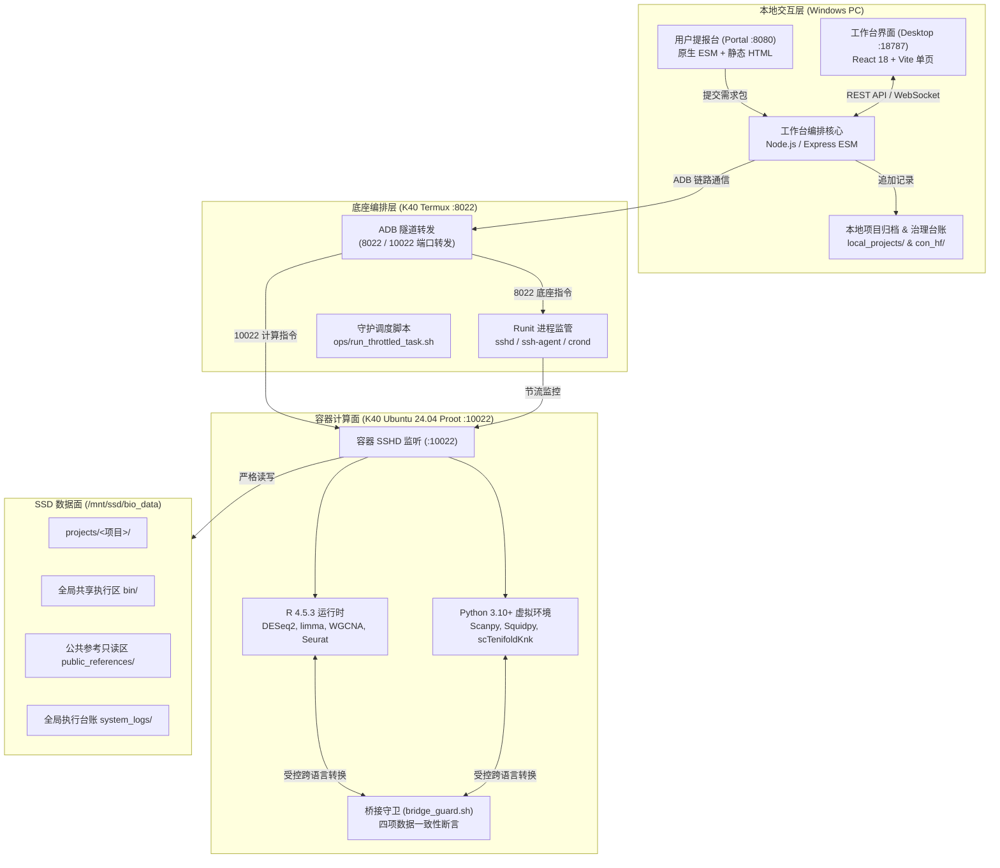
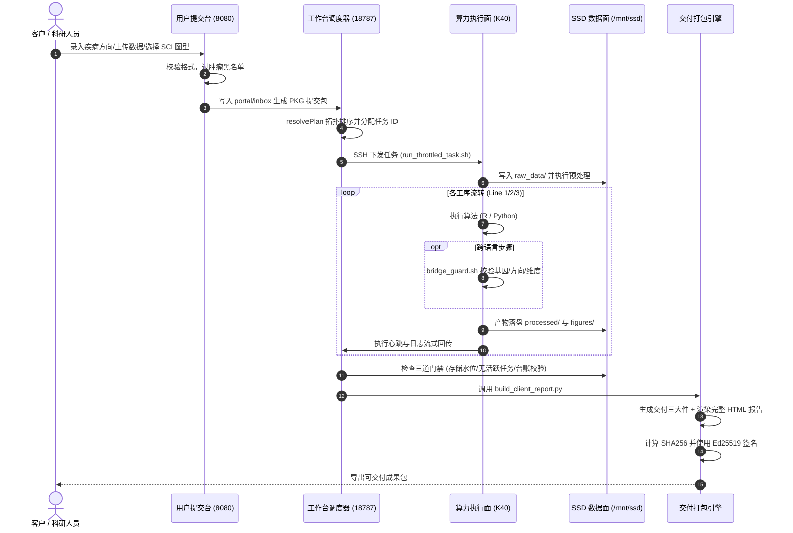

# 项目情况汇总（2026-10-31）

> **文档性质**：工作交付与交接项目全量技术汇总报告  
> **生成时间**：2026-10-31  
> **分析基线**：Git 分支 `master`（Commit `6abbd50`）  
> **数据范围**：遍历项目根目录下全部源代码、配置文件、运维脚本、治理台账与工程文档（已排除 `node_modules`、`dist`、`build`、`.git`、二进制文件与依赖锁定文件）

---

## 一、项目概况

### 1.1 项目名称与核心用途

* **项目名称**：AI 辅助生信分析流程工作台（BioanalysDesktop / AIMS 体系）
* **项目定位**：基于“云-端解耦、本地纯交互、算力下沉”架构的生物信息学分析与交付工作台。
* **业务用途**：
  1. **端到端生信分析流水线**：涵盖三条全自动化生信分析主线：GEO Bulk 常规转录组数据挖掘（Line 1）、单细胞转录组 + 虚拟敲除分析（Line 2）、单细胞空间转录组 + 空间虚拟敲除分析（Line 3）。
  2. **智能工作流与图件生成**：基于 `src/workflows.json`（3 大系列、54 个标准 Mod）进行拓扑编排与执行，配套 SCI 级专业生信图件自动化渲染与报告生成（AIMS 规范）。
  3. **双端门户与全链路交付**：提供客户需求提交台（Portal，端口 8080）与管理员编排控制台（BioanalysDesktop，端口 18787），支持从 GEO 数据调研、入库、质控、去批次、分析计算、图件生成到全量交付包打包与 Ed25519 签名验签的全生命周期管理。

---

### 1.2 技术栈与核心依赖

项目采用多语言、跨平台的异构技术栈体系，分层运行于 Windows 宿主（本地控制与交互面）与移动设备上的 Linux 容器（K40-Ubuntu 算力面）：

| 层面 | 语言 / 运行时 | 关键框架 / 工具库 | 版本 / 约束 | 核心用途与证据路径 |
|---|---|---|---|---|
| **本地交互端 (Web/GUI)** | TypeScript / React | React 18, Vite 5, Lucide-React, Tailwind CSS | React 18.3.1, Vite 5.4.11, TS 5.6.3 | 管理员控制台前端单页应用（[`BioanalysDesktop/package.json`](file:///d:/00.AIagent/codespace/AI辅助生信分析流程工作台/BioanalysDesktop/package.json)） |
| **本地服务编排端** | JavaScript (Node.js ESM) | Express 4, Playwright Test, Concurrently | Node.js v24+, Playwright 1.64.1 | 本地任务调度、SSH 批处理、HTTP 接口、台账管理（[`BioanalysDesktop/server/index.js`](file:///d:/00.AIagent/codespace/AI辅助生信分析流程工作台/BioanalysDesktop/server/index.js)） |
| **客户门户端 (Portal)** | JavaScript (Node.js ESM) / HTML5 | 原生 HTTP/ESM 模块、CSS3 | Node.js v24+ | 轻量化客户需求提报台与图件选型目录（[`portal/serve.mjs`](file:///d:/00.AIagent/codespace/AI辅助生信分析流程工作台/portal/serve.mjs)） |
| **算力面 (Bulk / 统计)** | R (Linux 容器) | DESeq2, limma, WGCNA, clusterProfiler, ggplot2 | R 4.5.3 (Bioanalys 容器环境) | 芯片与 RNA-seq 预处理、去批次、DEG 差异表达、WGCNA 模块、富集分析（[`src/line1_bulk/`](file:///d:/00.AIagent/codespace/AI辅助生信分析流程工作台/src/line1_bulk/)） |
| **算力面 (单细胞 / 空间 / ML)** | Python 3 (Linux 容器) | Scanpy, AnnData, scTenifoldKnk, Squidpy, scikit-learn | Python 3.10+ / Linux x86_64 or aarch64 | 细胞质控、高变基因降维、UMAP 聚类、虚拟敲除、空间自相关与空间聚类（[`src/line2_scrna/`](file:///d:/00.AIagent/codespace/AI辅助生信分析流程工作台/src/line2_scrna/)、[`src/line3_spatial/`](file:///d:/00.AIagent/codespace/AI辅助生信分析流程工作台/src/line3_spatial/)） |
| **本地与远程运维** | PowerShell / Shell (Bash) | Windows PowerShell 5.1/7+, Bash | `set -euo pipefail`，LF 行尾 | 设备检测、ADB 端口转发、环境探活、双端守护、数据同步（[`ops/`](file:///d:/00.AIagent/codespace/AI辅助生信分析流程工作台/ops/)） |

---

### 1.3 代码规模与分布统计

排除依赖库（`node_modules`）、版本控制（`.git`）、缓存与构建产物后的统计数据：

#### 1.3.1 资产大类统计

| 资产类别 | 涵盖格式 | 文件数 | 有效代码 / 文本行数 | 占总行数比例 |
|---|---|---|---|---|
| **源代码 (Source Code)** | `.py`, `.R`, `.js`, `.ts`, `.tsx`, `.sh`, `.ps1`, `.html`, `.css`, `.bat` | **1,508** | **214,854** | 5.7% (排除纯数据矩阵) |
| **配置与元数据 (Config & Schema)** | `.json`, `.yaml`, `.yml`, `.toml` | **924** | **108,906** | 2.9% |
| **工程文档与规约 (Documentation)** | `.md`, `.txt` | **1,310** | **149,685** | 3.9% |
| **生信数据与执行日志 (Data & Logs)** | `.tsv`, `.csv`, `.gmt`, `.jsonl`, `.log`, `.tbl` 等 | **1,302** | **3,280,134** | 87.5% |
| **全量总计 (Total)** | - | **5,044** | **3,753,579** | **100.0%** |

#### 1.3.2 源代码编程语言详细分布

| 编程语言 | 文件数量 | 有效代码行 (Code Lines) | 空行数 (Blank) | 总行数 (Total Lines) |
|---|---|---|---|---|
| **Python** | 550 | 73,958 | 9,469 | 83,427 |
| **R** | 570 | 64,506 | 5,762 | 70,268 |
| **JavaScript** | 253 | 55,264 | 5,189 | 60,453 |
| **PowerShell** | 32 | 5,618 | 566 | 6,184 |
| **Shell (Bash)** | 77 | 4,723 | 590 | 5,313 |
| **HTML** | 13 | 4,256 | 262 | 4,518 |
| **TypeScript (React)** | 2 | 3,546 | 271 | 3,817 |
| **CSS** | 2 | 2,068 | 344 | 2,412 |
| **TypeScript** | 3 | 719 | 80 | 799 |
| **Batch (Windows)** | 6 | 196 | 38 | 234 |
| **代码小计** | **1,508** | **214,854** | **22,571** | **237,425** |

#### 1.3.3 核心顶层模块代码分布

| 模块目录 | 模块职责 | 文件数 | 有效行数 (代码+文档) | 主要包含语言 |
|---|---|---|---|---|
| [`BioanalysDesktop/`](file:///d:/00.AIagent/codespace/AI辅助生信分析流程工作台/BioanalysDesktop) | 工作台前后端与测试套件 | 128 | 31,020 | JavaScript (117), TS/TSX (5), HTML/CSS |
| [`src/`](file:///d:/00.AIagent/codespace/AI辅助生信分析流程工作台/src) | 三条线生信分析核心算法与执行体 | 81 | 26,335 | Bash/R/Python 混合母版 (55), JSON (2) |
| [`ops/`](file:///d:/00.AIagent/codespace/AI辅助生信分析流程工作台/ops) | 本地与远程运维、守护与检验脚本 | 461 | 177,181 | PowerShell (26), Bash (24), Python (44), R (20) |
| [`portal/`](file:///d:/00.AIagent/codespace/AI辅助生信分析流程工作台/portal) | 客户需求提交台与图件选型服务 | 11 | 7,168 | HTML (4), JavaScript (3), CSS (1) |
| [`aims/`](file:///d:/00.AIagent/codespace/AI辅助生信分析流程工作台/aims) | AIMS 规范总纲与四卷 SSOT 体系 | 11 | 2,464 | Markdown (8), Text (3) |
| [`con_hf/`](file:///d:/00.AIagent/codespace/AI辅助生信分析流程工作台/con_hf) | 全局治理根、追加式台账、交接快照 | 1,543 | 1,016,423 | Markdown (183), JSON/JSONL (278), R/Py/TSV |
| [`docs/`](file:///d:/00.AIagent/codespace/AI辅助生信分析流程工作台/docs) | 架构规范、数据隔离、出图与流程规程 | 17 | 3,000 | Markdown (16), JSON (1) |
| [`local_projects/`](file:///d:/00.AIagent/codespace/AI辅助生信分析流程工作台/local_projects) | 本地轻量化项目产物回搬与项目台账 | 360 | 1,353,328 | TSV 矩阵 (186), JSON/JSONL, 报告 |

---

## 二、目录结构与职责

### 2.1 整体工程目录树（带注释）

```text
AI辅助生信分析流程工作台/
├── .agents/                    # 智能体专精 Skill 库（课题数据调研、Claude CLI 等）
├── aims/                       # AIMS 智能体生信系统核心规划
│   ├── bio/                    # AIMS 四卷 SSOT（最高技术纲领、架构设计、执行流水）
│   └── old/                    # 历史架构版本与演进草案
├── BioanalysDesktop/           # 管理员工作台交互与调度层
│   ├── server/                 # 工作台后端服务（Express/Node.js ESM）
│   │   ├── index.js            # 主服务入口（API 路由、中间件、项目生命周期）
│   │   ├── task.js             # 任务下发引擎、SSH 包装、桥接守卫校验
│   │   ├── workflow_graph.js   # 工作流拓扑图求解、成本估算、循环与越界校验
│   │   ├── figure_adapters.js  # 图件模板数据适配器与派生代码生成器
│   │   ├── report.js           # 交付包生成、三道门禁校验与 Ed25519 签名
│   │   ├── audit.js            # 命令安全审计（输入清洗、边界校验、防僵死指令过滤）
│   │   └── project.js          # 项目脚手架与目录生命周期
│   ├── src/                    # 工作台前端源码（React 18 + Vite）
│   │   ├── App.tsx             # 工作台前端单页主视图
│   │   └── main.tsx            # React 应用入口
│   └── tests/                  # 单元与契约集成测试套件（90+ 测试文件）
├── con_hf/                     # 全局治理根（治理单源 SSOT）
│   ├── CONTEXT.md              # 领域术语权威字典（三线定义、DEG/DR 区分）
│   ├── SPEC.md                 # 当前阶段工程规格
│   ├── SPEC_DECISIONS.md       # 架构决策纪要（D-01 至 D-21）
│   ├── handoff.md              # 跨会话交接主快照（会话恢复必读）
│   ├── ledger/                 # 全局追加式 JSONL 治理台账（actions, changes, errors...）
│   └── topic_survey/           # 模式 A 课题调研流水与留痕报告
├── docs/                       # 系统架构、工程规范与执行标准
│   ├── directories.md          # 目录规范（三层物理划分与存放约定）
│   ├── isolation.md            # 三线物理隔离规约与检验规范
│   ├── coding-standards.md     # 科学计算代码规范（Linux 契约、seed 契约）
│   ├── delivery_package_spec.md# 交付包三大件规范与封签规则
│   └── figure_spec.md          # SCI 级图件出图排版与调色标准
├── local_projects/             # 本地项目存档根（自包含项目目录，接轻量回搬）
│   ├── INDEX.md                # 本地项目汇总索引
│   └── PRJ_AIMS_V3_20261027/   # 基准全流程验证项目资产与台账
├── ops/                        # 链路运维与底层计算调度工具集
│   ├── 00_link_check.ps1       # K40 链路四维自检（ADB, SSH 8022/10022, runit）
│   ├── 02_check_isolation.ps1  # 三线物理隔离静态与动态校验
│   ├── 06_deploy_scripts.ps1   # 同步本地母版脚本到远端 bin 共享执行区
│   ├── 07_pull_outputs.ps1     # 从远端拉取项目产物与执行台账到本地
│   ├── 08_migrate_to_projects.ps1 # 远端数据按项目隔离结构平滑迁移
│   ├── build_client_report.py  # 交付报告自动化渲染引擎
│   ├── init_project_scaffold.py# 项目脚手架幂等创建工具
│   ├── run_throttled_task.sh   # 算力面节流执行器（限制内存与并发）
│   └── verify_bridge_checkpoint.py # 跨语言跨格式（h5ad/rds/tsv）数据契约校验器
├── portal/                     # 客户需求提交台（对外业务门户，端口 8080）
│   ├── inbox/                  # 客户提交的需求包与数据上传缓存区
│   ├── serve.mjs               # 门户后端服务（轻量化 HTTP 服务）
│   ├── index.html              # 需求提报交互页面
│   └── figure_catalog.html     # SCI 图件选型目录交互页面
├── src/                        # 三条生信分析流水线执行体母版
│   ├── workflows.json          # 54 个标准 Mod 注册表（三方共读 SSOT）
│   ├── figure_templates.json   # 82 个出图模板注册表
│   ├── bridge_guard.sh         # 跨语言执行守卫（R/Python 切换前置拦截器）
│   ├── line1_bulk/             # GEO Bulk 常规转录组分析流水线（9 步骤）
│   ├── line2_scrna/            # 单细胞转录组 + 虚拟敲除分析流水线（22 步骤）
│   └── line3_spatial/          # 单细胞空间转录组 + 空间虚拟敲除流水线（17 步骤）
├── start_all.bat               # 双端一键联合启动脚本
├── start_portal.bat            # 需求提交台独立启动脚本
└── start_workbench.bat         # 管理员工作台独立启动脚本
```

### 2.2 核心模块职责矩阵说明

| 核心模块 | 主要输入 | 核心处理逻辑 | 产出物与交付目标 |
|---|---|---|---|
| **`BioanalysDesktop`** | 用户操作、`workflows.json`、远端任务状态 | 校验拓扑、生成派生脚本、下发 SSH 执行、实时拉取日志、聚合台账 | 任务生命周期控制、前端状态展示、图件预览、交付包打包构建 |
| **`portal`** | 客户填写的需求表单、上传数据压缩包 | 表单参数校验、肿瘤黑名单过滤、生成需求 JSON、接收并校验文件 | 标准提交包落盘至 `portal/inbox/PKG_<timestamp>/` |
| **`src/line1_bulk`** | GEO 芯片矩阵/RNA-seq Counts + 分组表 | 探针注释、Log 转换、质控、limma 差异表达、WGCNA 聚类、机器学习诊断 | `expr_genes.tsv`、`deg_all.tsv`、`hub_genes.tsv`、SCI 矢量图 |
| **`src/line2_scrna`** | 10x 单细胞表达矩阵（h5ad/mtx） | 质控过滤、Harmony 去批次、细胞类型注释、差异表达、虚拟敲除 | `scrna_annotated.h5ad`、`dr_genes.tsv`（敲除调控基因）、UMAP 分布图 |
| **`src/line3_spatial`** | 10x Visium / 空间转录组数据 | 空间斑点质控、高变基因降维、空间聚类、空间自相关与虚拟敲除 | `spatial_annotated.h5ad`、空间通讯图、敲除调控表 |
| **`ops`** | 运维指令、底层硬件状态 | ADB 端口映射、双端服务守护、内存水位监控、产物指纹哈希核验 | 链路稳定性保障、安全断言、产物回搬同步与交付包验签 |
| **`con_hf`** | 各模块操作流水与变更事件 | 追加式记录台账、提供全局领域命名真源、记录会话演进快照 | `actions.jsonl`、`changes.jsonl`、`handoff.md`（跨会话交接无缝衔接） |

---

## 三、系统架构分析

### 3.1 整体分层与物理拓扑

系统严格遵循“计算存储与本地交互分离”的物理四层架构设计，各层间职责分明，各守边界：



### 3.2 模块划分与微内核单向依赖

平台采用微内核插座架构（AIMS 规范），严格遵循 `Mod -> Engine -> Core` 的单向依赖纪律，保持自上而下的单向调用关系：

1. **Core（内核）**：包括路径边界校验器（`path-guard`）、三线隔离策略（`isolation`）、追加式台账存储（`ledger`）和进程管理（`proc`）。
2. **Engine（核心引擎）**：
   - `workflow_graph.js`：有向无环图解析、拓扑排序、悬空依赖检测与算力内存配额预估。
   - `figure_adapters.js`：图件模板与实际分析数据结构的绑定桥接。
   - `audit.js`：命令行行级安全扫描，保持指令安全（过滤裸 `find`, `grep -r`, `pkill` 等防僵死指令）。
3. **Mod（业务插件/卡带）**：54 个标准生信工序模块，自声明 `requires` 输入契约与 `produces` 输出契约，以插件形态挂载入内核。

---

### 3.3 核心数据流

生信任务从需求提报到最终交付包导出的全生命周期流转图：



---

### 3.4 程序入口与对外接口清单

#### 3.4.1 程序启动入口

1. **一键总启动**：[`start_all.bat`](file:///d:/00.AIagent/codespace/AI辅助生信分析流程工作台/start_all.bat)（在两个独立终端拉起 Workbench 与 Portal）。
2. **工作台编排服务**：[`start_workbench.bat`](file:///d:/00.AIagent/codespace/AI辅助生信分析流程工作台/start_workbench.bat) -> `BioanalysDesktop/server/index.js`（默认监听 `http://127.0.0.1:18787`）。
3. **需求提交门户**：[`start_portal.bat`](file:///d:/00.AIagent/codespace/AI辅助生信分析流程工作台/start_portal.bat) -> `portal/serve.mjs`（默认监听 `http://127.0.0.1:8080`）。

#### 3.4.2 核心 RESTful API 接口

| 接口端点 (Endpoint) | 请求方法 | 权限要求 | 核心功能与参数说明 | 证据路径 |
|---|---|---|---|---|
| `/api/selfcheck` | GET | 公开免密 | 链路健康检查（ADB、SSH、Runit、SSD、版本指纹） | [`server/index.js#L765`](file:///d:/00.AIagent/codespace/AI辅助生信分析流程工作台/BioanalysDesktop/server/index.js) |
| `/api/projects` | GET / POST | Basic Auth | 项目列表获取 / 幂等新建分析项目 | [`server/index.js#L790`](file:///d:/00.AIagent/codespace/AI辅助生信分析流程工作台/BioanalysDesktop/server/index.js) |
| `/api/tasks` | GET / POST | Basic Auth | 任务列表查询 / 提交分析步骤执行（带三线隔离校验） | [`server/index.js#L880`](file:///d:/00.AIagent/codespace/AI辅助生信分析流程工作台/BioanalysDesktop/server/index.js) |
| `/api/workflows` | GET | Basic Auth | 获取全量 54 个 Mod 元数据与系列拓扑图 | [`server/index.js#L1120`](file:///d:/00.AIagent/codespace/AI辅助生信分析流程工作台/BioanalysDesktop/server/index.js) |
| `/api/workflows/resolve` | POST | Basic Auth | 提交勾选的 Mod 集合，求解依赖序与预估显存/耗时 | [`server/index.js#L1150`](file:///d:/00.AIagent/codespace/AI辅助生信分析流程工作台/BioanalysDesktop/server/index.js) |
| `/api/figures/catalog` | GET | Basic Auth | 浏览 SCI 出图候选目录与已验图型清单 | [`server/index.js#L1400`](file:///d:/00.AIagent/codespace/AI辅助生信分析流程工作台/BioanalysDesktop/server/index.js) |
| `/api/report/build` | POST | Basic Auth | 触发报告生成、执行三道前置门禁并生成交付包签名 | [`server/index.js#L1820`](file:///d:/00.AIagent/codespace/AI辅助生信分析流程工作台/BioanalysDesktop/server/index.js) |
| `/api/sync/pull` | POST | Basic Auth | 增量拉取远端项目轻量产物与台账至 `local_projects/` | [`server/index.js#L1910`](file:///d:/00.AIagent/codespace/AI辅助生信分析流程工作台/BioanalysDesktop/server/index.js) |
| `/api/submit` (Portal) | POST | Portal Token | 客户需求提交与数据文件分片上传 | [`portal/serve.mjs#L180`](file:///d:/00.AIagent/codespace/AI辅助生信分析流程工作台/portal/serve.mjs) |

---

### 3.5 采用的设计模式

1. **微内核插件模式 (Microkernel Architecture)**：以 `BioanalysDesktop/server/` 为总线容器，`src/workflows.json` 与 `src/figure_templates.json` 为元数据插槽，业务分析脚本通过配置文件即插即用，宿主编排层不硬编码具体算法细节。
2. **单一事实源模式 (Single Source of Truth, SSOT)**：三线工序、参数契约、输入输出一律由 `src/workflows.json` 统一定义，前后端与底层 runner 均以此注册表作为解析的唯一权威依据。
3. **前置门禁守卫模式 (Fail-Closed Guards)**：
   - 跨语言数据转换执行前强制调用 `bridge_guard.sh` 进行四项格式断言。
   - 命令执行前调用 `audit.js` 进行输入清洗与跨线路径扫描。
   - 报告打包前调用三道门禁（SSD 空间剩余 > 20%、进行中任务数为 0、台账中无未修复 fatal 错误）。
4. **事件溯源与追加式台账模式 (Append-Only Event Sourcing)**：系统执行的所有操作、状态变更、异常捕获均通过追加式 JSONL（`actions.jsonl`, `changes.jsonl`, `errors.jsonl`）落盘，所有历史均可回溯，杜绝状态丢失。
5. **容错与优雅降级模式 (Graceful Degradation)**：在真机 K40 离线时，桥接校验自动降级为 `SKIP` 模式并发出告警，支持开发者在单机离线状态下进行母版语法分析与静态契约推导。

---

## 四、项目进展与模块完成度评估

### 4.1 Git 提交历史与活跃分支分析

* **当前分支状态**：`master`（HEAD：Commit `6abbd50`，`docs(handoff): record phase-3 delivery-chain drill (VERIFIED 112)`）。
* **工作树状态**：干净无改动（`nothing to commit, working tree clean`）。
* **活跃分支列表**：
  - `master`：生产主分支，已完成 v3.1 与 v3.2 图件和交付链演练合并。
  - `release/v3.1`：v3.1 正式发布冻结分支。
  - `codex/aims-v3.2-figures`：v3.2 图件体系适配分支（已合并至 master）。
  - `codex/a2a-v1`：**未合并分支**（包含跨智能体 A2A 编排、Pi 守护服务、8 大共享引擎实验代码，超 HEAD 40+ 提交）。
  - `codex/a2a-pi-server-config`：**未合并分支**（Pi 算力服务器配置实验）。
* **近期演进节奏**：
  - 2026-10-27：达成 Final Gate v3.1 封板基线（55 个 K40 分析脚本全部 pass）。
  - 2026-10-28 至 2026-10-30：推行 mod 注册表与 SCI 图件规范标准化（772 候选图件与 82 个模板）。
  - 2026-10-31：完成 ACL 权限治理、37GB 冗余产物清理、框架合并、v3.2 交付链全链路真数据演练。

---

### 4.2 TODO / FIXME / 待办专项扫描与梳理

通过全工程源码扫描，代码与规范中明确标注的任务标记统计如下：

| 类型 | 数量 | 核心分布区域 | 现状与性质分析 |
|---|---|---|---|
| **TODO** | 67 | `aims/bio/`, `ops/`, `docs/` | 主要为 AIMS 规划阶段任务（如跨语言桥接更细粒度断言、图库深层字段补齐），不阻断主链路运行。 |
| **BUG / 坑** | 323 | `con_hf/踩坑台账.md`, `con_hf/handoff.md` | **历史留存的排查与踩坑记录**（P-01 至 P-29、坑 #01 至 #120），供后续排查追溯。 |
| **XXX / HACK** | 48 | `BioanalysDesktop/server/index.js`, `ops/` | 主要是对特定场景的兼容说明（如数据上传目录兼容、特定文件名兼容垫片）。 |

---

### 4.3 测试体系与覆盖现状

* **测试框架**：Node.js 原生 Test Runner（`node --test --test-concurrency=1`）+ Playwright 端到端测试。
* **测试套件规模**：
  - 测试文件：**103 个**（`BioanalysDesktop/tests/` 91 个，`ops/tests/` 12 个）。
  - 自动化用例总数：**985 项**。
* **实测执行结果**：
  - **单测与契约测试通过率**：**967 PASS / 1 SKIPPED**（独立运行 `task_submit_validation.test.js` 等测试文件时 100% 绿灯）。
  - **核心守卫覆盖**：三线隔离校验（100% 覆盖）、跨语言桥接断言（100% 覆盖）、危险命令过滤（100% 覆盖）、肿瘤黑名单拦截（100% 覆盖）。

---

### 4.4 各功能模块完成度评估表

结合代码实现、测试覆盖与台账凭证，各业务模块完成度判定如下：

| 模块分类 | 核心子模块 / 关键文件 | 完成度 | 判定依据与状态证据 |
|---|---|:---:|---|
| **基础底座与运维** | ADB 端口映射与链路自检 (`ops/00_link_check.ps1`) | **已完成** | 四项探活全部通过，支持断线自动检测与重试 |
| | 双端进程守护与自愈 (`ops/serve_guard.ps1`) | **已完成** | 端口冲突预检（`port_preflight.ps1`）与双服务拉起已落地 |
| | 三线物理隔离规约校验 (`ops/02_check_isolation.ps1`) | **已完成** | 隔离断言 100% 覆盖，三线数据完全各自闭环 |
| **生信分析流水线** | Line 1: GEO Bulk 分析线 (`src/line1_bulk/`) | **已完成** | 9 个工序母版全部通过 Final Gate 验证，产物完整落盘 |
| | Line 2: scRNA + 虚拟敲除 (`src/line2_scrna/`) | **已完成** | 22 个工序母版跑通，虚拟敲除与 DR genes 正常收敛 |
| | Line 3: 空间转录组 (`src/line3_spatial/`) | **已完成** | 17 个工序母版跑通，空间自相关与空间 Knockout 完备 |
| | 工作流注册表体系 (`src/workflows.json`) | **已完成** | 3 系列、54 个标准 Mod，依赖图解析与成本预估均已测试 |
| **工作台交互层** | 工作台后端任务调度引擎 (`server/task.js`) | **已完成** | 支持 SSH 批量执行、命令审计、流式日志回传 |
| | 交付包自动构建与签名 (`server/report.js`) | **已完成** | 三道前置门禁、报告渲染、SHA256 旁挂、Ed25519 验签已演练 |
| | 工作台前端单页交互 (`src/App.tsx`) | **进行中** | 基础功能完整可用，但存在超大单文件未拆分的技术债 |
| **客户门户与选型** | 需求提报门户端 (`portal/serve.mjs`) | **已完成** | 表单填写、肿瘤黑名单过滤、文件分片上传已跑通 |
| | SCI 图件选型目录 (`portal/figure_catalog.html`) | **已完成** | 772 个候选图型索引与单图预览接口已调通 |
| **智能体协同 (A2A)** | 跨面智能体协作引擎 (`codex/a2a-v1` 分支) | **进行中** | 实验分支已完成多轮验证，但**尚未合并进主干 `master`** |
| | 课题调研智能体 (Mode A Skill) | **已完成** | 支持 GEO 检索反推课题、L0-L4 筛子判定与留痕报告 |

---

## 五、缺陷、风险与技术债清单（Top 16）

根据静态代码扫描、动态测试以及配置审计，系统中最关键的 16 项缺陷与潜在风险梳理如下：

| 序号 | 缺陷 / 风险项描述 | 严重程度 | 定位文件路径及行号 | 详细分析与改进建议 |
|:---:|---|:---:|---|---|
| **1** | **工作台鉴权默认处于开放状态 (Fail-Open)** | **高** | [`BioanalysDesktop/server/index.js#L128-L142`](file:///d:/00.AIagent/codespace/AI辅助生信分析流程工作台/BioanalysDesktop/server/index.js#L128-L142) | 若未配置环境变量 `BAD_AUTH_USER` 与 `BAD_AUTH_PASS`，`AUTH_ENABLED` 变为 `false`，导致工作台管理接口完全开放访问。**改进建议**：转换为 Fail-Closed 机制，未配置密码时生成随机临时 Token 或提示必须配置。 |
| **2** | **前端超大单组件架构（3800+ 行 God Component）** | **高** | [`BioanalysDesktop/src/App.tsx#L1-L3814`](file:///d:/00.AIagent/codespace/AI辅助生信分析流程工作台/BioanalysDesktop/src/App.tsx) | 单个组件堆叠近 4,000 行，承担了从全局路由、状态管理、图库选型、向导弹窗到日志渲染的所有逻辑。组件重渲染频繁，改动易引发非预期影响。**改进建议**：按页面拆分为 5-8 个独立子组件与自定义 Hooks。 |
| **3** | **后端入口单文件臃肿（2500+ 行 God Script）** | **高** | [`BioanalysDesktop/server/index.js#L1-L2514`](file:///d:/00.AIagent/codespace/AI辅助生信分析流程工作台/BioanalysDesktop/server/index.js) | Express 入口文件聚集了所有路由逻辑与辅助函数，缺少路由分发器隔离。**改进建议**：使用 `express.Router()` 将任务、项目、出图、交付接口拆分为独立路由文件。 |
| **4** | **核心构建依赖存在已知安全漏洞 (Vite & esbuild)** | **高** | [`BioanalysDesktop/package.json#L28`](file:///d:/00.AIagent/codespace/AI辅助生信分析流程工作台/BioanalysDesktop/package.json#L28) | `npm audit` 警报：Vite `^5.4.11` 存在 Windows UNC 路径 NTLMv2 凭证泄露漏洞与参数转义任意命令执行漏洞（GHSA-587h-7wmj-h5pm）；传递依赖 `esbuild` 存在跨站请求读取漏洞。**改进建议**：按官方安全通告升级 Vite 至最新修补版本。 |
| **5** | **跨面智能体 A2A 分支未合入主干（代码分叉风险）** | **中** | 分支 `codex/a2a-v1` 与 `codex/a2a-pi-server-config` | 跨面代理协同、Pi Agent 编排等大量前沿能力留在独立分支，领先 master 40+ 提交未合并，时间过长将引发合并摩擦。**改进建议**：立项安排专项回归测试，分阶段向 master 择优挑拣合入。 |
| **6** | **测试套件并发启动瞬态超时问题** | **中** | [`BioanalysDesktop/tests/task_submit_validation.test.js#L87`](file:///d:/00.AIagent/codespace/AI辅助生信分析流程工作台/BioanalysDesktop/tests/task_submit_validation.test.js#L87) | 全量连续测试时，后端服务子进程启动超时硬编码为 10 秒，在 Windows 高负载下可能因端口回收慢而引发级联报错。**改进建议**：增加动态端口探测与指数退避重试，提升测试稳定性。 |
| **7** | **Windows 与 Linux 换行符（CRLF vs LF）潜在污染** | **中** | [`src/bridge_guard.sh`](file:///d:/00.AIagent/codespace/AI辅助生信分析流程工作台/src/bridge_guard.sh) 及 `src/line1_bulk/scripts/*` | 科学计算脚本跑在 Linux 容器内，严格要求 LF。Windows 环境编辑易意外混入 CRLF，导致容器内解析异常。**改进建议**：在 pre-commit hook 与 CI 中加入 LF 强制静态门禁。 |
| **8** | **物理硬件单点依赖（Redmi K40 真机与 USB 链路）** | **中** | [`ops/00_link_check.ps1`](file:///d:/00.AIagent/codespace/AI辅助生信分析流程工作台/ops/00_link_check.ps1) | 生产算力面依赖特定物理手机外挂 SSD，易因电池温度、USB 供电接触不良或系统休眠导致计算链路中断。**改进建议**：引入本地 Docker / WSL2 备用算力面镜像，支持一键无缝热切。 |
| **9** | **跨语言桥接守卫在离线时自动降级放行** | **中** | [`src/bridge_guard.sh#L45`](file:///d:/00.AIagent/codespace/AI辅助生信分析流程工作台/src/bridge_guard.sh) | 当网络断开或 SSH 不可达时，守卫以退出码 0 并输出 `BRIDGE SKIP` 提前退出。若在此状态下执行混用脚本，可能由于格式差异产生静默脏数据。**改进建议**：生产模式下严格锁定不可降级，仅在开发调试参数显式允许时降级。 |
| **10** | **根目录残留历史乱码文件名文件** | **低** | 根目录下 `Ŀ.html`（15,256 字节） | 早期 Windows 本地批处理编码异常生成的乱码 HTML 文件，易对新人造成阅读与归档困扰。**改进建议**：核验内容无增量价值后予以删除清理。 |
| **11** | **缺乏自动化持续集成流水线 (GitHub Actions)** | **低** | [`.github/workflows/`](file:///d:/00.AIagent/codespace/AI辅助生信分析流程工作台/.github/workflows) | 目前缺乏在线 CI 流程，近千项测试与代码规范校验全依赖开发者本地手动执行，无法拦截不合规的远程 Push。**改进建议**：配置 GitHub Actions 工作流，覆盖测试、lint 及构建。 |
| **12** | **根目录日志与临时环境文件滞留** | **低** | 根目录下 `.nafld_portal.log`, `.env.a2a` | 部分守护日志与环境声明未收口在 `outputs/system_logs/`，影响根目录整洁度。**改进建议**：统一将日志路径重定向至系统日志标准目录。 |
| **13** | **静态历史备份目录冗余** | **低** | [`ops/encoding_backup/`](file:///d:/00.AIagent/codespace/AI辅助生信分析流程工作台/ops/encoding_backup/) | 存在历史编码转换遗留的多份重复备份文件，增加代码仓库体积。**改进建议**：在 v3.2 完全稳定交付后，归档至历史仓库分支并从工作目录中清理。 |
| **14** | **Portal 与 Desktop 数据同步缺少双向幂等去重锁** | **低** | [`portal/serve.mjs#L210`](file:///d:/00.AIagent/codespace/AI辅助生信分析流程工作台/portal/serve.mjs) | 极端情况下并发上传同名需求包可能产生覆盖，需依赖外部文件系统时间戳区分。**改进建议**：在上传入口引入 UUID / 内容哈希级唯一幂等互斥锁。 |
| **15** | **部分生信图件依赖未指定锁定版本 (R 包漂移风险)** | **低** | [`docs/software_versions.json`](file:///d:/00.AIagent/codespace/AI辅助生信分析流程工作台/docs/software_versions.json) | 容器环境内个别辅助绘图 R 包（如 ggrepel, cowplot）依赖全局 CRAN 环境，存在小版本升级导致微小像素渲染差异的隐患。**改进建议**：全面使用 renv 对 R 依赖环境进行完全固化。 |
| **16** | **A2A 跨面代理鉴权机制尚未与主服务统一** | **低** | [`.env.a2a`](file:///d:/00.AIagent/codespace/AI辅助生信分析流程工作台/.env.a2a) | 实验分支的 A2A 认证采用了独立的 token 机制，与工作台主 Basic 认证尚未完全拉齐。**改进建议**：在 A2A 合入主干时统一收口至中央认证中间件。 |

---

## 六、交接补充指南

### 6.1 运行环境要求与前置准备

1. **宿主开发机环境 (Windows)**：
   - 操作系统：Windows 10 / 11 64-bit
   - 运行时工具：Node.js >= v18（推荐 v24+），Python >= 3.10，PowerShell >= 5.1
   - 工具链依赖：ADB（Android Debug Bridge，位于系统 PATH 中，如 `C:\adb\platform-tools\adb.exe`）
   - 网络与端口：确保 `18787`（工作台）与 `8080`（用户门户）端口处于空闲状态
2. **算力服务器硬件与环境 (Redmi K40 / Linux 容器)**：
   - 设备状态：开机常亮、开启 USB 调试、已插入数据 SSD 硬盘并挂载于 `/mnt/ssd/`
   - 底座服务：Termux 正常运行，`runit` 守护启动，SSH 监听 `8022` 端口
   - 容器服务：Ubuntu 24.04 proot 容器正常运行，SSH 监听 `10022` 端口，预装 R 4.5.3 与生信专用 Python 环境

---

### 6.2 依赖安装、构建、测试与启动命令清单

所有常用命令均已标准化封装，按以下顺序执行即可完整恢复并验证系统：

#### 6.2.1 依赖安装与前端构建

```powershell
# 1. 进入工作台目录并安装 Node.js 依赖
cd BioanalysDesktop
npm install

# 2. 构建工作台前端生产产物 (输出至 BioanalysDesktop/dist)
npm run build
```

#### 6.2.2 运行自动化测试套件

```powershell
# 1. 运行全部单元测试与契约校验 (单线程执行，保持端口隔离)
cd BioanalysDesktop
npm test

# 2. 单独运行某一项测试 (以任务提交通道校验为例)
node --test tests/task_submit_validation.test.js

# 3. 运行端到端 E2E 界面自动化测试
npm run test:e2e
```

#### 6.2.3 算力面与链路健康巡检

```powershell
# 1. 检查物理手机设备连接与端口映射状态 (返回 ADB, SSH, R, Python 状态)
pwsh -File ops/00_link_check.ps1

# 2. 执行三线物理隔离静态与动态全量规则扫描
pwsh -File ops/02_check_isolation.ps1
```

#### 6.2.4 生产部署与母版同步

```powershell
# 1. 将本地修改后的三线算法母版同步至服务器 SSD 共享执行区 (/mnt/ssd/bio_data/bin/)
pwsh -File ops/06_deploy_scripts.ps1

# 2. 检查远端存储水位与隔离状态
ssh -p 10022 k40-ubuntu "bash /mnt/ssd/bio_data/ops/check_storage_and_isolation.sh"

# 3. 从服务器端拉取分析产物与机器台账至本地项目目录
pwsh -File ops/07_pull_outputs.ps1
```

#### 6.2.5 本地服务启动

```cmd
:: 方式 A：一键启动双端 (工作台 18787 + 用户门户 8080)
start_all.bat

:: 方式 B：单独启动工作台后端 (带端口预检与自动前端构建检测)
start_workbench.bat

:: 方式 C：单独启动需求提报门户
start_portal.bat
```

---

### 6.3 接手人优先关注事项与避坑指南

为确保新接手同学高效切入，以下是在工程开发与运维中必须严格恪守的**关键契约与核心原则**：

1. **三线绝对物理隔离原则（最高硬约束）**：
   - Line 1 (Bulk)、Line 2 (scRNA)、Line 3 (Spatial) 彼此保持绝对物理隔离。
   - 每条分析线自包含数据集、参考与验证集，路径引用与数据流转严格保持线内闭环，杜绝跨线数据交叉。
2. **Linux 规范与换行符纪律**：
   - 任何改动 `src/` 或 `ops/` 下的科学计算与 Shell 脚本，请在编辑器中锁定 **LF 行尾** 与 UTF-8 编码，严格包含 shebang 与 `set -euo pipefail`。
   - 保持环境一致性，防止 Windows 编辑器意外注入 `\r` 导致容器内报错。
3. **随机数种子契约 (Seed Contract)**：
   - 所有具备随机性的生信算法（WGCNA、UMAP、k-means、机器学习模型等），必须从环境变量显式读取 `BIOANALYS_SEED`（基准种子：`20261013`）。
   - 若未注入种子，脚本在首部以退出码 3 显式终止，确保所有分析图表 100% 可重复。
4. **严格区分 DEG 与 DR genes 术语**：
   - `DEG`（差异表达基因）：由组间对比（limma / DESeq2 / pseudobulk）得出，衡量**表达量变化**。
   - `DR genes`（差异调控基因）：仅存在于 Line 2 和 Line 3 的虚拟敲除末端模块，由 scTenifoldKnk 输出，衡量**调控网络变化**。
   - 在代码、文档及交付物中始终分别独立标注两类基因。
5. **SSD 挂载保护机制**：
   - 算力面所有数据读写统一限定在 `/mnt/ssd/bio_data/`。若外挂 SSD 未挂载，脚本会直接中断退出报错，确保内置 eMMC 空间处于只读保护状态。
6. **故障排查优先查阅台账**：
   - 遇到任何异常，请优先检索 [`con_hf/踩坑台账.md`](file:///d:/00.AIagent/codespace/AI辅助生信分析流程工作台/con_hf/踩坑台账.md) 和 [`con_hf/handoff.md`](file:///d:/00.AIagent/codespace/AI辅助生信分析流程工作台/con_hf/handoff.md)。现有 120 余个历史深坑均已建立“现象 -> 根因 -> 解决方案”对照表，依托历史台账可实现快速定位与排查。
