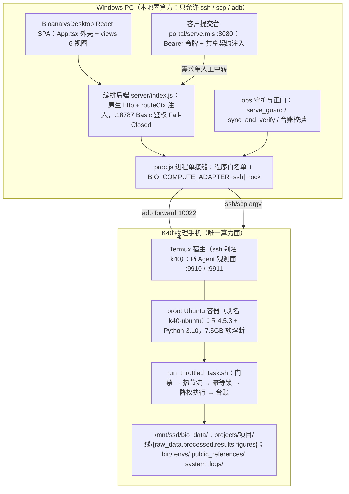

# 项目情况汇总（2026-11-01）

> **文档性质**：工作交付与交接项目全量技术汇总报告
> **生成时间**：2026-11-01
> **分析基线**：Git 分支 master，Commit f663b58（docs(con_hf): 第三十三轮交接）
> **数据范围**：排除 node_modules、dist、.git、__pycache__、Python 便携发行版、artifacts/outputs/local_projects/project_data/reference 等数据与依赖区后，遍历仓库全部源代码、配置、运维脚本与文档；统计口径见 1.3。
> **取代**：_archive/项目情况汇总2026-10-31.md（该文件基线为 6abbd50，含已被修正的 Express 依赖表述与过期规模口径）

---

## 一、项目概况

### 1.1 项目名称与核心用途

- **项目名称**：AI 辅助生信分析流程工作台（BioanalysDesktop / AIMS 体系）
- **项目定位**：基于"云-端解耦、本地纯交互、算力下沉"架构的生物信息学分析与交付工作台。本地 Windows PC 只做编排与交互，全部计算下沉到物理手机 K40（Termux + proot Ubuntu 容器）（证据：docs/isolation.md、ops/run_throttled_task.sh、BioanalysDesktop/server/proc.js 白名单）。
- **业务用途**：
  1. 三条全自动生信分析主线：GEO Bulk 转录组挖掘（line1_bulk）、单细胞 + 虚拟敲除（line2_scrna）、空间转录组 + 空间虚拟敲除（line3_spatial），三线物理隔离（证据：server/domain.js:16 LINES；docs/isolation.md）。
  2. 工作流编排与出图：src/workflows.json 定义 3 大系列、54 个标准 Mod（本轮实测 stages 求和：line1=15、line2=22、line3=17）；src/figure_templates.json 登记 82 个出图模板；SCI 级图件自动渲染与报告生成（AIMS 规范，aims/ 目录）。
  3. 双端门户与全链路交付：客户需求提交台（portal，默认 127.0.0.1:8080，证据：portal/serve.mjs:11）与管理员编排控制台（127.0.0.1:18787，证据：server/index.js:75、start_workbench.bat），覆盖 GEO 调研、入库、质控、分析、出图、交付打包、Ed25519 签名验签全生命周期。

### 1.2 技术栈与核心依赖

| 层面 | 语言/运行时 | 关键框架与约束 | 证据 |
|---|---|---|---|
| 工作台前端 | TypeScript / React | React 18.3.1、Vite 5.4.21、TS 5.6.3，无路由库（单页 tab 状态机） | BioanalysDesktop/package.json |
| 工作台后端 | JavaScript（Node ESM） | 无 Web 框架：原生 node:http + 自研路由派发（非 Express，修正旧文档口径）。Node >= 22（CI 钉 22；本机实测 v24.19.0）。package.json 无 engines 字段（待确认：建议补） | server/index.js:217 http.createServer；.github/workflows/ci.yml node-version: 22 |
| 客户门户 | 原生 HTML/ESM | node:http 单文件服务 + 共享契约注入（shared/data_formats.mjs 为唯一真源） | portal/serve.mjs:218 |
| 算力面（容器） | R 与 Python | R 4.5.3 / Python 3.10+，DESeq2、limma、WGCNA、clusterProfiler、Scanpy、scTenifoldKnk、Squidpy 等 | docs/software_versions.json、src/line*/envs/manifest.txt（版本未在本轮对真机复核，标注：引自台账） |
| 本地运维 | PowerShell 5.1/7+、Bash | ops/ 下 26 个 ps1 + 25 个 sh；分析母版按 Linux 面写（LF、shebang、set -euo pipefail） | docs/coding-standards.md、AGENTS.md 硬规则 |
| 测试 | node:test、Playwright | 98 个 test.js（1071 tests）+ e2e 18 case；esbuild 打 SSR 渲染冒烟 | BioanalysDesktop/tests/、playwright.config.ts |
| 设备链路 | adb、ssh | k40 别名 = Termux 宿主；k40-ubuntu = proot 计算容器；adb forward 10022 | ~/.ssh/config（实测存在两 Host 段）、ops/00_link_check.ps1 |

### 1.3 代码规模统计（本轮实测，排除依赖/构建/数据区）

| 语言 | 文件数 | 总行 | 非空行 |
|---|---:|---:|---:|
| Python | 331 | 34,353 | 30,162 |
| R | 310 | 16,580 | 14,696 |
| JavaScript(.js) | 159 | 34,354 | 31,218 |
| .mjs | 49 | 9,625 | 8,835 |
| .cjs | 21 | 1,993 | 1,851 |
| TypeScript(.ts) | 6 | 1,313 | 1,190 |
| React(.tsx) | 9 | 4,214 | 3,926 |
| Shell(.sh) | 35 | 2,667 | 2,362 |
| PowerShell(.ps1) | 35 | 6,247 | 5,675 |
| HTML | 8 | 4,260 | 4,003 |
| CSS | 2 | 2,649 | 2,279 |
| Batch | 6 | 234 | 196 |
| 小计 | 971 | 118,489 | 106,393 |

口径说明：含 cn_debug/（366 文件取证区）与 ops/（431 文件）内的探针与测试脚本；Markdown 文档 261 份、JSON 317 份未计入代码。55 个分析母版为无扩展名文件（git ls-files 实测：line1 16、line2 22、line3 17，另各线 README）。

---

## 二、目录结构与职责

（完整规约正本：docs/directories.md。以下为本轮实测的带注释树）

```text
AI辅助生信分析流程工作台/
├── AGENTS.md                  # agent 导航指针 + 硬规则（每轮进上下文）
├── docs/                      # 17 份规范正本：isolation / coding-standards / directories /
│   │                          #   figure_spec / topic_sieve_spec（选题 L0-L4、T1-T9）/
│   │                          #   mattpocock-workflow-spec / ledger-schema 等
│   └── software_versions.json # 算力面版本钉
├── src/                       # 三线分析母版（Linux 运行面，无扩展名文件 = 1 步 1 母版）
│   ├── line1_bulk/scripts/    #   16 母版（deg_limma、wgcna_modules、external_validation…）
│   ├── line2_scrna/scripts/   #   22 母版（integrate_harmony、virtual_knockout、scenic_tf…）
│   ├── line3_spatial/scripts/ #   17 母版（spatial_knockout、spatial_domains…）
│   ├── line*/checkpoint/      #   桥接四项校验（checkpoint_*_bridge.py）
│   ├── bridge_guard.sh        #   跨语言桥接门禁（BIO_BRIDGE_MODE=local|ssh|auto，exit 2 契约）
│   ├── workflows.json         #   3 系列 54 Mod 编排定义
│   └── figure_templates.json  #   82 出图模板
├── BioanalysDesktop/          # 工作台前后端 + 测试
│   ├── server/                #   编排后端（index.js 入口 + routes/ 6 路由模块 + 前置层）
│   │   ├── proc.js            #     进程单接缝：ssh/scp/adb 白名单 + BIO_COMPUTE_ADAPTER mock|ssh
│   │   ├── remote_exec.js     #     k40-ubuntu 执行面（runRemote / runRemoteStrict）
│   │   ├── domain.js          #     路径契约真源（LINES / SSD_ROOT / PROJECTS_ROOT…）
│   │   ├── run.js             #     任务执行引擎（台账落盘；尚存 2 处直连 ssh，见 5.1）
│   │   ├── task.js            #     任务构造 + 节点探活 + 桥接校验
│   │   ├── report.js          #     交付构建 / 回搬 / 先验后签（Ed25519）
│   │   ├── ledger.js audit.js #     台账校验 / 命令越线审计
│   │   ├── selfcheck.js       #     五维环境自检（阈值写在文件头注释）
│   │   ├── reconcile.js       #     断链对账（只读探针，探不到绝不升级为失败）
│   │   ├── pi_agent*.js       #     Pi Agent 观测插槽（第三批合入，2026-11-01）
│   │   └── auth_runtime.js    #     临时口令退出即焚（08 号书第 3 项）
│   ├── src/                   #   React 前端：App.tsx 外壳 + views/ 6 视图 + views/shared/
│   ├── tests/                 #   98 个 node:test 文件 + e2e/portal.spec.ts
│   └── playwright.config.ts   #   e2e 双服务编排（9321/9322 + 测试凭据）
├── portal/                    # 客户需求提交台（serve.mjs + index.html，契约注入防副本漂移）
├── shared/                    # 跨端唯一真源：data_formats.mjs、upload_session.mjs
├── ops/                       # 运维正门：编号入口 00_~10_、sync_and_verify_remote.ps1、
│   │                          #   serve_guard.ps1 守护、check_storage_and_isolation.sh、
│   │                          #   run_throttled_task.sh（门禁+热节流+幂等锁+降权+台账）、
│   │                          #   ed25519_tools.mjs、secrets/（签名信任锚）
│   └── tests/                 #   ops 侧 Python 静态/行为测试（幂等锁 10 条在此）
├── configs/k40/               # 设备档案（device_profile、build_state、server_plan）
├── aims/                      # AIMS 规范四卷 SSOT（bio/ 现行、old/ 归档）
├── con_hf/                    # 治理根：handoff.md（33 轮）、SPEC_DECISIONS.md（D-xx）、
│   │                          #   踩坑台账.md（P-xx）、操作台账、ops_ledger、
│   │                          #   ledger/actions.jsonl、dispatch/ 派工票、P3 专项三件套
├── cn_debug/                  # 取证区（真机链路与图件审计证据，263 文件已跟踪，按裁定保留）
├── local_projects/ outputs/   # 本地项目回搬产物与出图产物（数据区，不纳入代码分析）
│   artifacts/ project_data/
├── reference/                 # 跨项目共享只读参考（服务器侧 public_references/ 的本地对应）
├── _archive/                  # 冷备归档区（README 登记搬入/未搬与引用方，2026-11-01 更新）
├── start_all.bat / start_workbench.bat / start_portal.bat   # 一键入口（端口预检+构建+起服）
└── .github/workflows/ci.yml   # CI：LF 检查、三线隔离静态检查、npm test、tsc、build
```

---

## 三、系统架构分析

### 3.1 物理拓扑与分层



图据：docs/isolation.md 目录层约束、server/proc.js:15 ALLOWED_LOCAL_PROGRAMS、
ops/run_throttled_task.sh 头部注释与实测执行序、server/task.js:29-31 默认节点池、
BioanalysDesktop/src/App.tsx VIEWS 数组。

### 3.2 模块划分与依赖方向

单向依赖，本轮未发现循环：

1. 前端 views 只 fetch /api/ 前缀，不 import 后端模块（除 shared/types.ts 纯类型与
   server/domain.js:16 的 LINES 常量真源，属有意共享）。
2. server/index.js 是装配层：前置辅助（鉴权、远端执行、台账、探针）定义在前，
   routeCtx 对象在其后构造（index.js:201-216 明写暂时性死区纪律），再按
   projects / diagnostics / pi-agent / figures / preview / report / upload / tasks 顺序
   派发；routes/ 的 6 个模块只吃注入，不自行 import 兄弟路由。
3. 远端执行只有两条口子：proc.js（ssh/scp/adb 白名单 + 计算面适配器）与
   remote_exec.js（k40-ubuntu 容器执行面）。Pi 观测走 k40 别名（Termux 宿主面），
   index.js:243-247 注释写明与容器执行面分离的理由。
4. 路径契约唯一真源 server/domain.js（SSD_ROOT:303、PROJECTS_ROOT:306、BIN_ROOT:312、
   ENVS_ROOT:315、LINES:16）。
5. portal 与工作台的三份共享契约（输入白名单、大小上限、肿瘤黑名单）唯一真源
   shared/data_formats.mjs 与 server/tumor_blacklist.js，由 portal/serve.mjs 注入
   window.__SHARED_CONTRACTS__，tests/portal_inject.test.js 15 条逐字段钉同源。

### 3.3 核心数据流

1. **需求进入**：客户 portal 提交（Bearer 令牌 → 肿瘤黑名单 20 条 → 5 GiB 上限 →
   分块断点续传 shared/upload_session.mjs）→ 收件箱落单（server/portal_inbox.js）→
   负责人在工作台建项部署（server/project.js、server/upload.js、server/task_input.js
   的 scp 上传加 stat 字节校验）。
2. **任务下发**：提交层构造命令（server/task.js 先过 audit.js 越线审计与
   runBridgeCheckSync 桥接校验，非法即 400）→ server/run.js 以
   setsid nohup bash ops/run_throttled_task.sh 下发（远端脱离，本机不承载进程树，
   踩坑台账 P-26）→ 远端依次过存储水位与跨线门禁、90°C 以上冷却、幂等锁
   （同逻辑步骤键互斥，撞锁排队，等满 exit 4）→ nice -n 10 与 ionice 降权执行 →
   台账落 system_logs，SSE 经 server/sinks.js 实时回传日志。
3. **结果回搬与交付**：server/report.js 远端跑 build_client_report.py → pullDeliverables
   先取远端 sha256sum 基准再落盘（缺失即 REPORT_HASH_MISSING）→ 交付 tar 的
   CHECKSUMS.sha256 与 CHECKSUMS.sig 用 ops/secrets/ed25519_public.pem 验签，失败删
   污染包、严禁本地重算洗白（先验后签，提交 1cc7257 与 8198d46）→ 文本交付件写
   sha256 旁挂供客户独立复核。
4. **断链对账**：常驻 ssh 断开后 server/reconcile.js 做一次只读探针（产物路径清单
   NUL 分隔、base64 走 stdin，不进 ssh argv），按五种状态分类；探不到一律 unknown
   保持原判，绝不升级为失败（reconcile.js:1-7、:104）。

### 3.4 程序入口与对外接口

**入口**

| 入口 | 用途 | 证据 |
|---|---|---|
| start_all.bat | 双窗口起工作台 18787 与 portal 8080 | 文件内两条 start |
| start_workbench.bat | 仅工作台，先跑端口预检再按需 build | start_workbench.bat:19-36 |
| node BioanalysDesktop/server/index.js | 编排后端（开发态 node --watch） | package.json 的 dev:server |
| node portal/serve.mjs | 客户提交台，默认 127.0.0.1:8080 | portal/serve.mjs:11-14 用法注释 |
| ops/serve_guard.ps1 | 常驻守护（拉起、口令文件、外部进程保护） | serve_guard.ps1:49、:78、:134 |
| ops/sync_and_verify_remote.ps1 | 母版与脚本上服务器的唯一正门（先比后传、权限归一、台账） | tests/sync_script_guard.test.js 钉法 |

**工作台 REST 面**（本轮实测 40 个端点行，按 routes/ 模块分文件）

- /api/projects/：list、create、meta、deploy、steps 等
- /api/tasks/：submit（含 400 前置校验）、stream（SSE）、status、cancel、running、bridge-check
- /api/figures/：list、preview、adapt、project-preview、figure-templates
- /api/upload/：init、chunk、status、commit、abort（配额与断点续传）
- /api/report/：build、pull、preflight、deliver、text
- /api/selfcheck（五维加第 4 维双子灯 sub_checks）、/api/link、/api/ledger/、/api/files/、/api/health
- /api/pi-agent/：overview、calls、model、dispatch、task、task/cancel、logs（第三批新增，2026-11-01）

**portal 面**：/api/submit、/api/datafiles、/api/references（受保护）、
/api/sync/pending|claim|package|result（编排）、/health、/api/figure-templates。

**鉴权契约**：admin 面未配 BAD_AUTH_USER 与 BAD_AUTH_PASS 时 Fail-Closed 生成一次性
强口令并在控制台展示（index.js:88-100），临时口令文件在 exit 与 SIGINT/SIGTERM 即焚
（server/auth_runtime.js）；测试态由 NODE_TEST_CONTEXT 豁免，BIO_TEST_FORCE_FAIL_CLOSED=1
可反向压过豁免（tests/auth.test.js 负路径钉此语义）。

### 3.5 采用的设计模式（逐项有代码证据）

| 模式 | 落点 | 证据 |
|---|---|---|
| 接缝加测试垫片 | proc.js 唯一出进程点；默认导入使 mock.method 可拦；适配器顶层短路 | server/proc.js；tests/compute_adapter.test.js 12 条；P-07 守卫 |
| 依赖注入 | routeCtx 注入路由模块，禁兄弟 import | index.js:206-216 |
| Fail-Closed | 鉴权、未知适配器、未知参数、引擎缺失、缺 seed 一律阻断 | index.js:88-100；proc.js:52-63；src/bridge_guard.sh；docs/coding-standards.md |
| 追加式台账 | system_logs 任务台账、con_hf/ledger/actions.jsonl、ops_ledger.md | docs/ledger-schema.md；reconcile.js:96-101 |
| 单一真源加注入 | shared/data_formats.mjs、server/domain.js、图件三本台账 | portal_inject.test.js 15 条、deploy_and_parity_guard.test.js |
| 状态机分类 | 对账五态；自检四档且 unknown 重于 pass | reconcile.js:25-31；selfcheck.js:406 |
| 策略开关渐进收紧 | BIO_COMPUTE_ADAPTER、BIO_BRIDGE_MODE、BIO_IDEMPOTENT_LOCK、BIO_PIN_CPUS | proc.js；bridge_guard.sh；run_throttled_task.sh |
| 垂直切片与 tracer bullet | P3 每刀先红后绿一条原子提交 | git log 3f637c9 到 e21e021 |

---

## 四、项目进展与模块完成度评估

### 4.1 Git 历史与分支状态

- 近 30 天 86 次提交；基线 f663b58 于今日达成（同日 15 次，P3 专项收官）。
- master：主线，已跟踪工作树干净（仅两个未跟踪 Python 便携目录，见 5.10）。
- codex/a2a-v1：领先 51、落后 56。P3-03 三批已择优处理完毕（mock adapter a590dd6、
  幂等锁 7e79599、PiAgentChat e21e021），其余 36 条 rejected 加 9 条暂缓的逐项理由在
  con_hf/2026-11-01_P3-03_a2a_pick_candidate_census.md；禁止整支 merge（827 文件、+62,184）。
- codex/aims-v3.1-release 与 release/v3.1：v3.1 交付线（均有远端跟踪）。
- codex/aims-v3.2-figures：图件线（远端有跟踪）。
- codex/a2a-pi-server-config：Pi server 配置试验，用途：待确认。
- 框架更新后10.31：中文名本地分支，无远端跟踪，用途：待确认；纯英文命名是仓库
  纪律，确认后建议清理。
- git status 无 index.lock 异常；.git 写路径实测可用。

### 4.2 TODO / FIXME / HACK 扫描

对 src/、BioanalysDesktop/{server,src,tests}、ops/、portal/、shared/、cn_debug/lib/ 执行
git grep -n -I -E 扫 TODO、FIXME、HACK、XXX：**0 命中**。

不是没有待办，而是本项目用显式台账替代隐式注释：待办落在
con_hf/figure_pending_admission_ledger.md（图件准入）、con_hf/handoff.md 轮次记录、
con_hf/踩坑台账.md（P-xx，每条配守卫测试）、con_hf/SPEC_DECISIONS.md（D-xx 决策）。
接手人应以这四份为待办真源，代码注释里的提醒只作局部提示。

### 4.3 测试体系与覆盖现状

| 层 | 规模 | 本轮实测 | 备注 |
|---|---|---|---|
| node:test 单元与集成 | 98 文件 | 1071 tests / 1070 pass / 0 fail / 1 skipped，88s | 单并发是硬纪律（共享端口与台账） |
| Playwright e2e | 1 文件 18 case | 18 passed，44s | admin 面凭据断口 2026-11-01 修复，历史首次全绿 |
| 前端渲染冒烟 | 10 直渲 case | 全绿 | esbuild 加 renderToStaticMarkup，宿主无 jsdom |
| 静态守卫 | 10 多个文件 | 全绿 | LF 与 BOM、具名导入禁令、SEAM_MIGRATED_MODULES、母版约定、82 模板对账 |
| ops 侧 | ops/tests 的 py | 幂等锁 7 静态加 3 行为全绿 | 需 Git-Bash |
| 真机取证 | 三线全链 | line1、line2 已取证；line3 待确认 | cn_debug/2026-10-2*_m1_*.mjs 取证 runner |

跑测试的环境前提（交接必读，本轮再次复现）：TEMP 与 TMP 必须指向工作区内
（在 BioanalysDesktop 下置 $env:TEMP=$env:TMP 为 $PWD 下 .tmp 目录），否则
portal_inject 等成片假红。本轮首跑用外部 TEMP 实测 15 红，指回工作区后全绿。
另有 5 条设备红（consistency 的 K40 DNS、link 的 adb 三件、proc 的真实链路）在链路
不可达时属设计行为：链路不通就红。

### 4.4 各功能模块完成度

| 模块 | 状态 | 证据与剩余 |
|---|---|---|
| 三线分析母版与桥接四项校验 | 已完成 | src/line*/scripts、checkpoint_*.py、bridge_guard.sh；真机 line1 与 line2 全链取证，line3 全链复跑待确认 |
| 后端路由拆分 P3-01 | 已完成（收尾在案） | server/index.js 298 非空行（目标小于 400），36 端点入 routes/；剩余宽 import 与 routeCtx 未用符号静态审计 |
| 前端视图拆分 P3-02 | 已完成 | src/App.tsx 121 非空行（第三批挂两视图后，P3-02 收官时为 115）、6 加 1 视图文件；渲染覆盖缺口 2026-11-01 关闭（40e5a86）。PipelineDAGView 无独立文件（DAG 归 OnboardingView，已写入 P3 正本） |
| 进程单接缝迁移 | 已完成四刀 | task.js（3f637c9）、selfcheck.js 与 reconcile.js（5095663）、report.js（feb9cce）入缝；run.js 两处待裁定（见 5.1） |
| 幂等锁、热节流、降权 | 已完成并真机验证 | 7e79599；K40 实测活锁挡下 exit 4、排队接管、锁与标记零残留 |
| Pi Agent 观测插槽 | 已完成（写路径有缺口） | e21e021；面板只读观测可靠，模型切换与派发依赖未准入运行时脚本（见 5.2） |
| 交付打包与验签链 | 已完成 | report.js 先验后签加 54 条测试；公钥信任锚 ops/secrets/ed25519_public.pem |
| A2A 运行时引擎层（44 文件） | 暂缓（用户裁定） | census 逐项废弃理由在案；整体准入另立议题 |
| 选题准入体系 | 规约完成，执行进行中 | docs/topic_sieve_spec.md（L0-L4、T1-T9）、docs/topic_survey_sop.md（模式 A） |
| 图件模板准入 | 进行中 | figure_pending_admission_ledger.md 多行缺三件套：真实样例、适配器映射、plot_matrix 证据 |

---

## 五、缺陷、风险与技术债清单（14 项，按严重程度排序）

| 编号 | 严重度 | 问题 | 位置（可定位行号） | 说明与建议 |
|---|---|---|---|---|
| 5.1 | 高 | run.js 两处 ssh 直连绕过单接缝 | BioanalysDesktop/server/run.js:208、:380 | 任务下发主路径不受 BIO_COMPUTE_ADAPTER=mock 罩护。测试靠 childProcess 默认导入垫片可拦（run.js:9-11 注释），但 proc.js 头注释宣称的「唯一出口」审计面因此存在两个已知例外。第三十二轮交接已列为待裁定项，接手第一件事应给结论 |
| 5.2 | 高 | Pi 观测插槽引用未准入的运行时脚本 | server/pi_agent.js:29（模型锁与 ops/pi_a2a_daemon.sh 同源）、:157（exec bash $HOME/bin/pi_a2a_launch.sh） | master 的 ops 里 pi 系列只有 pi_seed_settings.sh 一个跟踪文件；模型切换与任务派发链路依赖远端 $HOME/bin 落点，真机操作会踩空。census 已把相关脚本登记为三批外 rejected。现状：只读观测可靠，写操作路径缺配套。面板上这两类按钮应在文档或 UI 上标注依赖 |
| 5.3 | 高 | 单点物理设备依赖 | configs/k40/、server/task.js:29-31 DEFAULT_COMPUTE_NODES 仅 k40-ubuntu | K40 是唯一算力面，sshd、Termux、proot、存储同机共命运（旧汇总缺陷 8）。故障转移框架已就位（selectComputeNode、routeTask、动作台账）但没有第二台真设备，failover 只有测试证据。幂等锁与热节流是当前唯一缓解 |
| 5.4 | 中 | README 测试基线口径过期 | BioanalysDesktop/README.md:84 | 写的是 848 tests（2026-10-24 口径），当前实测 1071。README 的 TEMP 前提（:92）仍正确，但规模数字会误导接手人判断是否新增红。应以 handoff.md 顶部轮次为准，README 待刷新 |
| 5.5 | 中 | CI 不覆盖分析面与 e2e | .github/workflows/ci.yml 全文 | CI 只有 LF 检查、ops/02_check_isolation.ps1、npm test、tsc、build。母版 bash -n、R parse、Python ast、Playwright e2e、台账校验 03_check_logs_remote.sh 都不在 CI；R 与 Python 侧回归完全依赖本地手动加真机。node-version 钉 22 而开发机 24.19，CI 面窄于本机面（差异未见引发问题，属隐性债） |
| 5.6 | 中 | Fail-Closed 随机口令打印 stderr，守护会持久化该流 | server/index.js:98-100（console.error 含明文口令）、ops/serve_guard.ps1:171-176（-RedirectStandardError 到 cn_debug/workbench_err.log） | 组合路径：serve_guard 拉起且未配 BAD_AUTH 时，一次性口令落盘进 err 日志。*.log 已被 .gitignore 兜住不入 git，本轮实测该文件不存在，属潜在暴露而非现行泄漏。建议 serve_guard 自己生成口令注入 env（它已有口令文件逻辑 :78），别让后端随机生成再走 stderr |
| 5.7 | 中 | 图件模板准入缺口挂账 | con_hf/figure_pending_admission_ledger.md（2026-10-31） | src/figure_templates.json 82 个模板中多行 pending：缺真实样例、缺适配器映射、缺 plot_matrix 证据，部分未绑定步骤（circularpacking、dendrogram、donut 等）。交付质量面风险，按台账建议批次列推进 |
| 5.8 | 中 | 取证区与备份文件治理债 | cn_debug/（263 跟踪文件）；git ls-files 实测 11 个 .bak 与 .before 跟踪副本（如 ops/verify_bridge_checkpoint.py.bak_20261024_r453） | 用户已裁定 cn_debug 保留并建索引不搬家（_archive/README.md 第三节）；那 11 个备份副本属同类债，宜统一登记进 _archive 或删除（历史都在 git 里）。低优先，但每次扫描都会撞上 |
| 5.9 | 中 | scp 硬编码转发端口与 root@127.0.0.1 | server/task_input.js:81-83（scp -P 10022 root@127.0.0.1） | 数据部署路径绑死当前 adb forward 拓扑；换端口或换设备即断，也不走 domain.js 的 target 常量口径。至少把 10022 与 root@127.0.0.1 收进 domain.js 配置真源 |
| 5.10 | 中 | 约 350MB 便携 Python 未处置 | 根 Python/（2,384 文件、174MB）、BioanalysDesktop/Python/（2,418 文件、175MB） | 2026-11-01 16:55 前后由其他进程装入（创建时间实测），未跟踪也未加进 .gitignore，git status 长期脏、任何全仓扫描与 grep 都被污染（本轮统计就得专门排除）。待裁定：删除或 ignore，不建议入库 |
| 5.11 | 低 | 测试对 TEMP 位置敏感，易制造假红 | 本轮实测：外部 TEMP 首跑 portal_inject 等 15 条成片红 | handoff 第三十二轮已记录。建议 package.json 的 test 脚本前置设 TMP，或加一条守卫测试，比靠文档纪律可靠 |
| 5.12 | 低 | 行数判定存在总行与非空行两套口径 | server/index.js 总 328 / 非空 298；src/App.tsx 总 134 / 非空 121 | P3 正本口径提醒已统一为非空行判定，但历史提交信息混用两口径，交叉核对阈值时容易误判达标与否。新文档注意标注口径 |
| 5.13 | 低 | 僵尸与试验分支 | 框架更新后10.31（中文名、无远端）、codex/a2a-pi-server-config | 用途待确认后删除。中文名还违反纯英文命名纪律 |
| 5.14 | 低 | 根目录 loose 交付快照 | 项目交付报告.html（仍被跟踪） | 同类的项目情况汇总2026-10-31.md 已按裁定移入 _archive/，这个 HTML 还留在仓库根，与交付快照归档裁定不一致。注意它被 con_hf、docs、aims 有 11 处活引用，先改引用再搬（登记见 _archive/README.md） |

### 5.15 已标注待确认的事实

- 容器内 R 与 Python 实际版本（本轮未重连真机跑版本探针，口径来自 docs/software_versions.json 台账）。
- line3 全链 17 步真机复跑状态（取证 runner 就绪，未在本轮执行）。
- Node engines 字段缺失是否为有意（CI 钉 22、本机 24）。
- 两个待确认分支（5.13）的用途。

---

## 六、交接补充指南

### 6.1 运行环境要求与前置准备

1. Windows 主机；Node.js 大于等于 22（CI 钉 22，开发机实测 v24.19.0）；
   Git for Windows（多项测试需要 bash 解释器，优先候选位 D:\Git\bin\bash.exe）。
2. K40 物理手机：Termux 加 proot Ubuntu，容器内有 /mnt/ssd/bio_data 树与 ops 部署；
   USB adb 连接并端口转发。链路自检一条命令：
   `pwsh -File ops/00_link_check.ps1`（adb、ssh k40、ssh k40-ubuntu、R 加 Python 四段）。
3. `~/.ssh/config` 需要两个 Host：`k40`（Termux 宿主，Pi 观测面）与 `k40-ubuntu`
   （proot 计算容器，分析执行面）。两者都经 127.0.0.1 的 adb forward（10022）。
4. 跑测试前先置 TEMP 进工作区（见 5.11），否则成片假红。

### 6.2 依赖安装、构建、测试与启动命令清单

```powershell
# 1. 工作台依赖
cd BioanalysDesktop; npm ci

# 2. 构建前端（产物 dist/，由 server/index.js 静态兜底服务）
npm run build

# 3. 全量测试（单并发是硬性纪律：共享端口与台账）
$env:TEMP = $env:TMP = "$PWD\.tmp"
node --test --test-concurrency=1 tests/*.test.js
#   现基线：1071 tests / 1070 pass / 0 fail / 1 skipped（约 88s）
npx tsc --noEmit          # 判据 exit 0

# 4. e2e（Playwright 自动起 portal:9321 与 admin:9322，测试凭据内置于 config）
npm run test:e2e          # 现基线 18 passed（约 44s）

# 5. 日常启动（三选一）
./start_all.bat           # 工作台 18787 + portal 8080 双窗口
./start_workbench.bat     # 仅工作台；内置端口预检，被占即拒启
node server/index.js      # 手工；未配 BAD_AUTH_USER 与 BAD_AUTH_PASS 时
                          #   Fail-Closed 生成临时强口令并在控制台显示（重启即换）

# 6. 正式使用（固定口令守护）
pwsh -File ops/serve_guard.ps1    # 口令文件模式；控制台与日志不印正式口令

# 7. 三线隔离与台账校验（改动 src/ 或部署后必跑）
pwsh -File ops/02_check_isolation.ps1
pwsh -File ops/04_check_logs.ps1

# 8. 母版与脚本部署对账（唯一正门，禁手工 scp）
pwsh -File ops/sync_and_verify_remote.ps1 -All
pwsh -File ops/06_deploy_scripts.ps1
pwsh -File ops/07_pull_outputs.ps1 -ProjectId <项目> -LineId <线>
pwsh -File ops/09_snapshot.ps1      # 产物快照
```

### 6.3 接手人优先关注事项与避坑指南

按优先级：

1. **三份正本先读**：`AGENTS.md`（硬规则，每轮进上下文）→ `docs/isolation.md`
   （三线隔离红线，优先级高于一切）→ `docs/mattpocock-workflow-spec.md`（做事方式：
   动手前对齐、每步有可判据、test-first、卡住先造反馈环）。规范正文在 `docs/`，
   `AGENTS.md` 只是指针，别在正文里找细节。
2. **接缝纪律**：任何新的远端调用一律走 `server/proc.js`（ssh/scp）或
   `remote_exec.js`（容器执行面）。绕过即触发 `tests/sync_script_guard.test.js` 的
   `SEAM_MIGRATED_MODULES` 守卫红。`run.js` 两处遗留直连是当前唯一已知例外（5.1），
   接手后先向需求方要裁定。
3. **母版是 Linux 面**：shebang、`set -euo pipefail`、LF、纯英文路径、755；Windows 里
   改完必须过 `ops/sync_and_verify_remote.ps1` 的 LF 与 BOM 门禁，CI 也会拦 CRLF。
   `ops/` 下 PowerShell 运维脚本不受此约束。
4. **退出码契约**：0 成功；1 自校验失败；2 参数或输入契约不满足；3 BIOANALYS_SEED
   未注入；4 幂等锁拒绝（本轮新增，与 0 到 3 不冲突）。别自造新码，先改
   `docs/coding-standards.md` 的表。
5. **台账与凭证**：`system_logs/` 台账的 line_id 与 project_id 违规会被
   `03_check_logs_remote.sh` 判红；跨项目引用一律违规。一切口令与 key 展示一律
   写 `<REDACTED>`；`.env.a2a`、`.tmp*/`、`*.auth_runtime.json` 已被 `.gitignore` 钉住，
   勿加回。
6. **热节流、幂等锁与 SSH 频率**：长任务只能经 `run_throttled_task.sh` 下发（降权、
   90°C 以上冷却、同逻辑步骤键互斥 exit 4）；**禁止并发 ssh 轮询**：proot 的 15 秒
   abort 环由 ssh 连接流喂出（踩坑台账 P-29），轮询下限 60 秒由
   `tests/p29_ssh_flow_guard.test.js` 钉死，`docs/termux_keepalive.md` 有完整理由。
7. **真机绿灯口径**：mock 与沙箱结果不得写成真机结论。K40 恢复后按 4.3 基线复跑，
   跑前先 `ops/00_link_check.ps1`，结果刷新进 `con_hf/handoff.md` 顶部轮次。
8. **在册坑先查再改**：`con_hf/踩坑台账.md`（P-01 到 P-29 以上）每条都有对应守卫
   测试；`con_hf/SPEC_DECISIONS.md`（D-xx）是决策真源。改代码前 grep 一遍台账编号。
9. **待办队列**（第三十三轮交接原话）：`run.js` 入缝裁定 → P3-01 宽 import 静态审计
   （逐条 `rg -w` 核对守卫，禁盲删）→ 真机全量复跑刷新基线 → 根 `Python/` 处置 →
   图件 pending 台账推进 → A2A 运行时整体准入议题。
10. **提交纪律**：每个可验证子步一条原子提交，提交信息写验证命令与结果；
    每步收尾更新 handoff 顶部轮次（本轮 handoff.md 已是 33 轮记录链）。

---

*本报告全部结论可由文中路径与行号复核；分析基线 `f663b58`（2026-11-01）。HEAD 之后
的变化以 `con_hf/handoff.md` 顶部轮次记录为准。*
