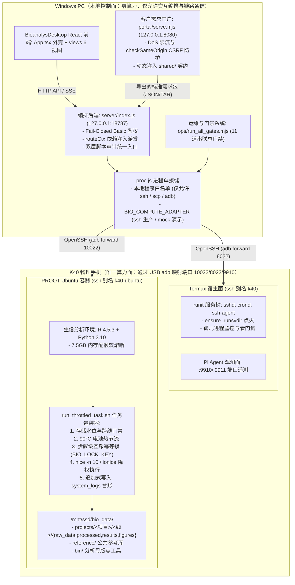

# 项目情况汇总（2026-11-04）

> **文档性质**：工作交付与交接项目全量技术汇总报告  
> **生成时间**：2026-11-04  
> **分析基线**：Git 分支 master，Commit dca4896（chore(ledger): 同步 pi_agent_telemetry 运行期观测记录）  
> **数据范围**：排除 node_modules、vendor、dist、build、target、.git、.npmcache、.pytest_cache、Python 便携发行版、_archive、outputs、artifacts、local_projects、project_data、reference 等依赖、构建产物与外部数据区后，遍历仓库全部源代码、配置、运维脚本与文档；统计口径见 1.3 节。  
> **前序版本**：项目情况汇总2026-11-01.md（基线 f663b58，经历 Round2 全量审查、11 道总门禁收口、图件预览溯源硬阻断、测试隔离静态门禁加固等重大演进，本报告全面刷新并取代旧版口径）。

---

## 一、项目概况

### 1.1 项目名称与核心用途

- **项目名称**：AI 辅助生信分析流程工作台（BioanalysDesktop / AIMS 体系）
- **项目定位**：基于"云-端解耦、本地纯交互、算力下沉"架构的生物信息学分析与交付工作台。本地 Windows PC 仅作任务编排、参数配置与交互展示，全部高负载生信分析重计算严格下沉至物理手机 K40（Termux 宿主 + proot Ubuntu 容器执行面）（证据：`docs/isolation.md`、`ops/run_throttled_task.sh`、`BioanalysDesktop/server/proc.js:15` ALLOWED_LOCAL_PROGRAMS 白名单）。
- **业务用途**：
  1. **三条全自动生信分析主线**：GEO Bulk 转录组常规挖掘（`line1_bulk`，15 个 Mod 步骤）、单细胞转录组 + 虚拟敲除（`line2_scrna`，22 个 Mod 步骤）、单细胞空间转录组 + 空间虚拟敲除（`line3_spatial`，17 个 Mod 步骤）。三线在数据存储、运行环境、结果目录上实施物理隔离，严禁跨线交叉取数（证据：`BioanalysDesktop/server/domain.js:16` LINES 常量；`src/workflows.json:23-145`；`docs/isolation.md`）。
  2. **标准化 SCI 级图件出图与交付报告生成**：`src/figure_templates.json` 登记 82 个 SCI 出图模板，当前 30 个核心模板已完成全要素准入并实现真机预览与渲染产物 SHA256 溯源硬阻断（证据：`ops/figure_preview_provenance.mjs:5-18`；`ops/build_figure_templates.cjs`）；配套 AIMS 规范四卷与自动报告组装引擎，输出符合学术出版标准的图表排版与全流程分析报告（证据：`aims/` 目录；`ops/build_client_report.py`）。
  3. **双端门户与全链路安全交付**：包含面向客户的需求单提交台（portal，默认运行于 `127.0.0.1:8080`，证据：`portal/serve.mjs:11`）与管理员编排控制台（默认运行于 `127.0.0.1:18787`，证据：`BioanalysDesktop/server/index.js:76`）。全链路覆盖需求填报、肿瘤黑名单筛查、分块断点续传、任务下发、实时日志 SSE 回传、产物自动回搬、Ed25519 非对称签名与离线四关防伪验签（证据：`shared/upload_session.mjs`；`ops/delivery_acceptance_core.mjs`；`ops/secrets/ed25519_public.pem`）。

### 1.2 技术栈与核心依赖

| 层面 | 语言/运行时 | 关键框架、依赖与约束 | 代码证据 |
|---|---|---|---|
| 工作台前端 | TypeScript / React | React 18.3.1、Vite 5.4.21、TypeScript 5.6.3。零路由库依赖（单页 Tab 状态机编排） | `BioanalysDesktop/package.json:22-35`；`BioanalysDesktop/src/App.tsx:28-40` |
| 工作台后端 | JavaScript（Node ESM） | 原生 `node:http` + 自研路由派发微内核（零 Express/Koa 第三方框架，避免依赖膨胀）。Node >= 22（CI 锁定 22；开发机实测 Node 24.19.0） | `BioanalysDesktop/server/index.js:10`、`index.js:76`；`.github/workflows/ci.yml:25` |
| 客户需求门户 | 原生 HTML5 / ESM | 单文件原生 `node:http` 服务（`portal/serve.mjs`），共享契约由服务端运行时动态注入，杜绝前端副本逻辑漂移 | `portal/serve.mjs:218`；`shared/data_formats.mjs`；`shared/requirement_schema.mjs` |
| 算力面（K40 容器） | R 与 Python | R 4.5.3 / Python 3.10+，包含 DESeq2、limma、WGCNA、clusterProfiler、Scanpy、scTenifoldKnk、Squidpy 等生信包 | `docs/software_versions.json`；`src/line*/envs/manifest.txt`（注：实际版本引自版本台账，待连接真机复核） |
| 本地运维与门禁 | Node ESM、PowerShell、Bash | 11 道串联总门禁（`ops/run_all_gates.mjs`）；分析母版遵循严格 Linux 面规范（shebang、`set -euo pipefail`、LF 行尾、纯英文路径、755 权限） | `ops/run_all_gates.mjs:40-66`；`docs/coding-standards.md`；`AGENTS.md` 硬规则 |
| 测试与验收体系 | node:test、Playwright | 144 个单元与集成测试文件（实测 1465 tests / 1464 pass / 0 fail / 1 skipped）、Playwright e2e（27 个端到端用例）、变异门禁（反证 7 道关键防线） | `BioanalysDesktop/package.json:13-14`；`ops/mutation_gate.mjs`；`ops/metrics_sync.mjs` |
| 设备通信链路 | adb、OpenSSH | `~/.ssh/config` 维护 `k40`（Termux 宿主观测面）与 `k40-ubuntu`（proot 容器计算面）两套 Host；adb 端口转发 10022/8022/9910/9911 | `ops/00_link_check.ps1`；`BioanalysDesktop/server/proc.js:28-36` |

### 1.3 代码规模统计（本轮实测）

统计口径说明：基于 Git 跟踪文件列表（`git ls-files`），严格排除第三方依赖目录（`node_modules`、`vendor`）、构建产物（`dist`、`build`、`target`）、版本库（`.git`）、缓存与上传临时区（`.npmcache`、`.pytest_cache`、`.uploads`）、便携发行版（`Python/`）、归档区（`_archive/`）、产物与参考数据区（`local_projects/`、`outputs/`、`artifacts/`、`project_data/`、`reference/`）以及各类二进制资产与锁定文件（`package-lock.json` 等）。

#### 纯代码规模统计（按开发语言分类）

| 语言类型 | 文件数 | 总行数 | 非空行数（SLOC） | 核心职责说明 |
|---|---:|---:|---:|---|
| JavaScript (.js) | 197 | 42,982 | 39,220 | 后端路由、核心引擎、测试套件、图件适配 |
| Python (.py) | 186 | 29,341 | 26,006 | 单细胞分析母版、桥接校验、报告构建、脚本门禁 |
| Shell / 无扩展名母版 | 109 | 27,366 | 24,568 | 54 步分析母版（无扩展名，Linux 面）、宿主看门狗与服务脚本 |
| JavaScript ESM (.mjs) | 66 | 13,217 | 12,192 | 门禁系统、交付验收、门户服务、共享契约 |
| PowerShell (.ps1) | 30 | 5,115 | 4,646 | 本地运维入口、链路检查、常驻守护、部署同步 |
| React (.tsx) | 10 | 4,506 | 4,202 | 工作台 React 视图组件（App 外壳与 6 大主视图） |
| HTML (.html) | 7 | 4,473 | 4,198 | 客户门户前端、静态画廊预览页 |
| R (.R / .r) | 46 | 2,865 | 2,575 | Bulk 转录组母版、图件渲染模板、R 环境引导标头 |
| CSS (.css) | 2 | 2,708 | 2,336 | 工作台与客户门户界面样式表 |
| JavaScript CJS (.cjs) | 19 | 2,174 | 2,035 | 图件注册表生成器、历史兼容工具脚本 |
| TypeScript (.ts) | 10 | 1,815 | 1,630 | 类型契约定义、Playwright e2e 测试脚本 |
| Batch (.bat / .cmd) | 3 | 117 | 98 | 本地一键启动脚本（端口预检与起服） |
| **纯代码合计** | **695** | **136,679** | **123,706** | **仓库纯代码资产总规模** |

#### 文档与配置资产统计

| 资产类型 | 文件数 | 总行数 | 非空行数 | 核心职责说明 |
|---|---:|---:|---:|---|
| Markdown (.md) | 223 | 47,244 | 37,368 | 架构规范、4 Argon 评审纪要、交接台账、踩坑记录 |
| JSON (.json) | 193 | 23,741 | 23,690 | 工作流编排、82 图件模板注册表、需求契约、测试期望 |
| 文本文件 (.txt) | 34 | 25,881 | 25,222 | 环境依赖清单（manifest）、软硬件配置文档 |
| YAML (.yml / .yaml) | 1 | 78 | 73 | GitHub Actions CI 持续集成门禁配置 |
| **文档与配置合计** | **451** | **96,944** | **86,353** | **工程治理与规范体系总规模** |

> **官方基线指标咬合**：按 `ops/metrics_sync.mjs` 定义的受控核心面（`BioanalysDesktop/server`、`BioanalysDesktop/src`、`portal`、`shared` 四个目录下的代码），当前官方基线锁定为 **21,412 SLOC**（非空行，69 个核心源文件），与 `BioanalysDesktop/README.md:84` 保持精确一致。

---

## 二、目录结构与职责说明

（完整规约正本参见 `docs/directories.md`。以下为本轮实测与代码证据锁定的带注释工程树）

```text
AI辅助生信分析流程工作台/
├── AGENTS.md                  # Agent 导航指针与硬规则（每轮强制载入：Linux 面、退出码、不使用 em dash、凭据脱敏）
├── docs/                      # 18 份工程规范正本（唯一真源）
│   ├── isolation.md           #   三线物理与数据隔离红线（最高优先级规则）
│   ├── coding-standards.md    #   编码标准（Linux 面、seed 契约、0-4 退出码规范）
│   ├── directories.md         #   全仓目录落点与职责规划正本
│   ├── figure_spec.md         #   SCI 级图件规范（色彩空间、排版、300DPI、语义三色）
│   ├── topic_sieve_spec.md    #   课题准入漏斗（L0-L4 过滤器与 T1-T9 判定标准）
│   ├── topic_survey_sop.md    #   模式 A 疾病课题调研标准作业规程（SOP）
│   ├── full_review_round2_plan.md # 全量审查 Round2 计划稿与梯队票图（Argon 裁定落地）
│   ├── software_versions.json #   算力面 R/Python 软件与包版本固定底账
│   └── termux_keepalive.md    #   K40 物理机常驻与保活避坑机制
├── src/                       # 三线生信分析母版真源（Linux 运行面，无扩展名 = 一步一母版）
│   ├── line1_bulk/scripts/    #   15 个 Bulk 转录组母版（l1_ingest_prep、deg_limma、wgcna_modules…）
│   ├── line2_scrna/scripts/   #   22 个单细胞母版（integrate_harmony、virtual_knockout、scenic_tf…）
│   ├── line3_spatial/scripts/ #   17 个空间转录组母版（spatial_domains、spatial_knockout…）
│   ├── checkpoint_*_bridge.py #   跨语言桥接四项严格校验器（行数、非空、列名、数值域）
│   ├── bridge_guard.sh        #   跨语言桥接门禁（BIO_BRIDGE_MODE=local|ssh|auto，exit 2 契约）
│   ├── workflows.json         #   3 系列 54 Mod 编排正本（产物契约、阶段序、内存磁盘配额）
│   └── figure_templates.json  #   82 个 SCI 出图模板注册表（30 ready 封板，字段与证据完全闭环）
├── BioanalysDesktop/          # 管理员编排工作台（交互面）
│   ├── server/                #   Node.js 原生后端（入口 + 路由模块 + 核心引擎）
│   │   ├── index.js           #     服务启动入口（端口监听、Fail-Closed Basic 鉴权、静态资产托管）
│   │   ├── proc.js            #     【关键接缝】本地子进程唯一出口（仅白名单 ssh/scp/adb + mock 适配器）
│   │   ├── remote_exec.js     #     k40-ubuntu 容器执行面（runRemote / runRemoteStrict）
│   │   ├── domain.js          #     全仓路径与数据契约唯一真源（LINES、SSD_ROOT、PROJECTS_ROOT 等）
│   │   ├── run.js             #     任务执行引擎（两层审计归一、nohup setsid 脱离下发、日志流回传）
│   │   ├── task.js            #     任务构造、节点探活、去注释语法预检
│   │   ├── report.js          #     交付物构建、远端 sha256 基准比对、先验后签打包（Ed25519）
│   │   ├── selfcheck.js       #     五维环境自检（硬件水位、三线隔离、哈希对齐、算力探活等）
│   │   ├── reconcile.js       #     断链对账引擎（只读探针，探不到保持 unknown，严禁升级为失败）
│   │   ├── pi_agent*.js       #     Pi Agent 观测插槽（9910/9911 隧道观测、状态遥测）
│   │   ├── auth_runtime.js    #     动态口令管理（退出即焚、Windows pid 进程存活性校验）
│   │   └── routes/            #     拆分后的子路由（projects、tasks、figures、upload、report、diagnostics）
│   ├── src/                   #   React 前端界面（Vite + React 18 + TS）
│   │   ├── App.tsx            #     前端外壳组件（单页 Tab 状态机、全局错误边界、断网提示）
│   │   ├── views/             #     6 大主视图（OnboardingView、FigureGalleryView、SelfCheckAdminView 等）
│   │   └── lib/               #     客户端分块上传工具、格式化工具
│   ├── tests/                 #   144 个 node:test 测试文件（1458+ 测试用例，单元/集成/契约全覆盖）
│   ├── playwright.config.ts   #   Playwright e2e 配置（双本地测试服务编排：portal:9321、admin:9322）
│   └── README.md              #   工作台使用说明与实测测试基线
├── portal/                    # 客户需求提交台（独立轻量服务）
│   ├── serve.mjs              #   原生 HTTP 提交服务（默认 8080，含 DoS 防护、CSRF 校验、动态契约注入）
│   └── index.html             #   单页提交应用（表单输入、差异档位配置、肿瘤黑名单拦截、分块上传）
├── shared/                    # 跨端唯一真源定义（消除桌面端与门户间的规则漂移）
│   ├── data_formats.mjs       #   输入格式白名单、文件大小上限
│   ├── requirement_schema.mjs #   客户需求单唯一校验器（三档阈值 loose/standard/strict，手写中文诊断）
│   ├── requirement_schema.json#   需求单 JSON Schema 机器声明面
│   └── upload_session.mjs     #   分块上传会话契约与断点续传状态计算
├── ops/                       # 运维、测试与门禁工程正门
│   ├── run_all_gates.mjs      #   【核心】单命令总门禁（11 道门禁串联，同构支撑本地与私有 CI）
│   ├── static_gate.mjs        #   四语种静态语言语法与规范门禁（shebang、语法、防污染、命令引号）
│   ├── mutation_gate.mjs      #   变异门禁（反证 7 道防线，确保门禁遇破坏必红）
│   ├── figure_preview_provenance.mjs # 预览与矩阵渲染产物 SHA256 溯源硬阻断门禁
│   ├── test_isolation_gate.mjs#   测试与门禁临时目录隔离静态门禁（防并发互删）
│   ├── dist_parity_gate.mjs   #   便携包关键资产同源校验门禁
│   ├── metrics_sync.mjs       #   全仓规模与测试基线同源同步器
│   ├── delivery_acceptance_core.mjs # 交付包四关离线验收与 Ed25519 验签器
│   ├── build_portable_package.mjs   # 绿色便携包构建器（四层收敛与自足环境打包）
│   ├── clean_workspace.mjs    #   工作区卫生清理工具（带 7 天白名单与神圣黑名单防护）
│   ├── run_throttled_task.sh  #   算力面任务包装器（门禁、90°C 热节流、幂等互斥锁、降权执行、台账记录）
│   ├── sync_and_verify_remote.ps1   # 代码部署唯一正门（先比后传、LF 归一、权限 755、远端对账）
│   ├── serve_guard.ps1        #   生产常驻守护脚本（自动重启、口令注入、外部进程防护）
│   └── secrets/               #   数字签名公钥信任锚（ed25519_public.pem）
├── configs/k40/               # 设备档案与硬件参数记录（device_profile、server_plan 等）
├── aims/                      # AIMS 生信工程规范四卷（SSOT 正本与历史演进）
├── con_hf/                    # 治理根基：追加式交接台账、决策记录与问题跟踪
│   ├── handoff.md             #   跨会话交接记录链（已记录至第三十四轮）
│   ├── argon_review_journal.md#   4 Argon 外部评审对话纪要（14 轮高强度架构对抗与决策演进）
│   ├── SPEC_DECISIONS.md      #   架构决策记录（D-01 至 D-30+）
│   ├── 踩坑台账.md            #   工程问题与踩坑记录（P-01 至 P-29+，均配守卫测试）
│   ├── figure_pending_admission_ledger.md # 图件模板准入台账
│   └── ledger/                #   追加式不可变动作台账（actions.jsonl、changes.jsonl）
├── cn_debug/                  # 取证区（真机执行日志、链路测试证据，按裁定保留并建立索引）
├── local_projects/ outputs/   # 本地数据区（回搬结果与出图产物，不纳入代码分析）
├── _archive/                  # 冷备归档区（登记归档文件清单与历史引用分析）
└── .github/workflows/ci.yml   # GitHub Actions 私有 CI 配置（gate-all 八道核心 + e2e 独立测试）
```

---

## 三、系统架构分析

### 3.1 物理拓扑与分层架构

系统严格遵循"交互控制面"与"算力计算面"物理隔离的架构原则：



### 3.2 模块划分与单向依赖方向

系统在代码组织上坚持单向依赖与关注点分离，无循环依赖：

1. **前端与后端完全解耦**：前端 `BioanalysDesktop/src/views/` 仅通过 REST API 和 SSE 长连接与后端通信，不直接引用后端逻辑。唯一共享的是 `server/domain.js` 中纯常量（如 `LINES`）与 `shared/types.ts` 类型契约。
2. **后端采用依赖注入（Dependency Injection）**：`server/index.js` 作为微内核装配器，在前置阶段初始化上下文对象 `routeCtx`（包含路径常量、进程接缝方法、远端执行器、审计器等），并按序注入给 `routes/` 下的子路由模块（`projects`、`tasks`、`figures`、`upload`、`report`、`diagnostics`）。子路由之间互不引用，避免模块网状缠绕。
3. **本地执行唯一收拢于进程接缝（`server/proc.js`）**：这是整个本地控制面的核心咽喉。所有对外部命令的调用必须经由 `runSync`、`runAsync`、`runStream` 派发。内部设立硬编码程序白名单（仅 `ssh`、`scp`、`adb`），任何其他命令调用直接拦截；同时内置 `childEnv` 兜底，补齐 Windows 环境下的 `%SystemRoot%` 变量，防止原生 OpenSSH 静默崩溃（退出码 255）。
4. **共享契约唯一真源**：`shared/` 目录下的 `data_formats.mjs` 与 `requirement_schema.mjs` 作为客户门户与管理工作台的唯一事实源。门户启动时通过正则替换将规则动态注入到客户端页面（`window.__SHARED_CONTRACTS__`），消除两端因手工复制规则产生的分歧。

### 3.3 核心数据流

```text
[客户需求阶段]
客户在 Portal (8080) 填报数据
  → 肿瘤黑名单筛查 (20 条高危特征)
  → 差异基因三档阈值校验 (loose/standard/strict)
  → 分块断点续传 (5MB 分块，带文件指纹)
  → Portal 生成标准化需求包与清单 (manifest)
  → 落入收件箱 (portal_inbox)

[项目立项与分析编排阶段]
管理员在工作台载入需求包
  → 自动解析数据集与分组
  → 服务端执行项目脚手架初始化 (projects/<项目>/<线>/)
  → 部署原始输入数据至远端 raw_data/ (带 stat 字节校验与 md5 对齐)
  → 构造待执行任务脚本

[任务下发与安全执行阶段]
任务提交进入引擎层
  → 双层脚本审计归一 (prepareAndAuditTask 校验越线路径与危险命令)
  → 远端命令动态插值 shellQuote 转义 (防命令拼接注入)
  → 跨语言桥接校验 (checkpoint_*_bridge.py 确认输入表结构完备)
  → 经 proc.js 单接缝执行 nohup setsid bash ops/run_throttled_task.sh 下发
  → 远端前置门禁：检查磁盘剩余容量 (>=20%)、校验禁止跨线规则
  → 电池热保护：温度超过 90°C 自动休眠冷却
  → 幂等锁互斥：以逻辑步骤为键原子抢占锁 (撞锁排队等待，超 1200s 则 exit 4)
  → 降权执行：nice -n 10 与 ionice 限制 CPU/IO 抢占
  → 实时日志流追加写入 system_logs，并通过 SSE 流式推送到前端终端

[成果回搬与交付验签阶段]
分析步骤全部完成
  → 远端执行 build_client_report.py 组装客户交付物 (HTML报告、图件、说明文件)
  → 计算远端所有交付物 SHA256 并生成 CHECKSUMS.sha256
  → 使用 Ed25519 私钥对 CHECKSUMS.sha256 进行数字签名，生成 CHECKSUMS.sig
  → 工作台通过 pullDeliverables 回搬交付物包
  → 本地离线执行四关严苛验收：
      第 1 关：公钥离线验签 (ed25519_tools.mjs 校验签名有效性)
      第 2 关：全文件 SHA256 咬合比对 (逐字节比对，禁止本地篡改重算)
      第 3 关：双向差集检查 (拦截未声明的幽灵私货文件)
      第 4 关：清单覆盖完备性校验
  → 验收通过后正式交付客户；任一关失败立即阻断并删除污染包
```

### 3.4 程序入口与对外接口

#### 系统运行入口

| 入口方式 | 用途与特性 | 证据来源 |
|---|---|---|
| `start_all.bat` | 生产一键启动：双 CMD 窗口并行拉起工作台（18787）与客户门户（8080） | `start_all.bat:1-12` |
| `start_workbench.bat` | 工作台单端启动：内置端口占用前置检测，静态资源按需 build | `start_workbench.bat:19-36` |
| `node BioanalysDesktop/server/index.js` | 开发者直接启动工作台后端（支持 `node --watch` 开发热重载） | `BioanalysDesktop/package.json:9` |
| `node portal/serve.mjs` | 独立启动客户门户服务（支持自定义 `--port` 参数） | `portal/serve.mjs:11-14` |
| `pwsh -File ops/serve_guard.ps1` | 生产级常驻守护：进程崩溃自愈、口令安全文件管理、日志防泄露 | `ops/serve_guard.ps1:49-134` |
| `pwsh -File ops/sync_and_verify_remote.ps1` | 代码与母版上机部署唯一正门（比对差异、LF 转换、权限 755、远端对账） | `ops/sync_and_verify_remote.ps1:1-80` |

#### 主要对外 API 接口（工作台 REST API 40+ 端点）

- **/api/projects/**：`GET /list`（项目列表与元数据）、`POST /create`（建项与目录脚手架初始化）、`GET /meta`、`GET /steps`（工作流步骤配置）。
- **/api/tasks/**：`POST /submit`（任务编译、审计与下发）、`GET /status`（运行状态查询）、`GET /logs`（SSE 实时流式日志）、`POST /cancel`（任务中止）、`GET /running`（活跃任务槽位）。
- **/api/figures/**：`GET /list`（图件清单）、`GET /image`（产物读取）、`GET /preview`（缩略图预览）、`GET /figure-templates`（82 模板元数据查询）、`POST /adapt`（图件重绘参数适配）。
- **/api/upload/**：`POST /init`（分块上传初始化，支持基于文件哈希的确定性 uploadId 派生）、`POST /chunk`（分片数据接收）、`GET /status`（断点续传水位查询）、`POST /commit`（分片组装与校验）、`POST /abort`（废弃上传清理）。
- **/api/report/**：`POST /build`（触发交付报告构建）、`POST /pull`（产物拉回本地）、`POST /preflight`（交付前置校验）、`GET /deliver`（交付包下载）。
- **/api/selfcheck**：五维环境自检接口（硬件水位、隔离完备度、母版哈希一致性、设备链路通信、计算面可用性）。
- **/api/pi-agent/**：`GET /overview`、`GET /calls`、`GET /model`、`POST /dispatch`（Termux 宿主面 Pi Agent 观测与遥测控制）。

#### 鉴权与安全机制

- **Fail-Closed 闭环鉴权**：管理工作台（18787 端口）在未显式配置环境变量 `BAD_AUTH_USER` 与 `BAD_AUTH_PASS` 时，自动生成高强度随机一次性口令并在控制台输出；绝不容忍无密裸奔（证据：`server/index.js:88-100`）。
- **口令生命周期与 PID 强绑定**：临时口令文件在正常退出（`exit`、`SIGINT`、`SIGTERM`）时自动销毁；若发生掉电或 `taskkill /F` 强杀，下次启动时通过进程存活性探测（校验文件记录的 PID 是否存活）自动判废并删除陈旧残留口令文件（证据：`server/auth_runtime.js:15-45`）。
- **Portal 深度防御**：客户门户引入基于滑动窗口的 IP 请求速率限制，防范爆破与拒绝服务攻击（DoS）；写操作端点强制实施 `checkSameOrigin` 校验，拦截跨站请求伪造（CSRF）（证据：`portal/serve.mjs:420`、`:1544`、`:1561`）。

### 3.5 采用的核心设计模式

| 设计模式 | 落地场景与代码实现 | 带来的工程收益与安全保障 |
|---|---|---|
| **接缝模式 (Seam Pattern)** | `BioanalysDesktop/server/proc.js` 作为本地子进程调用的唯一出口，仅暴露 `runSync`、`runAsync`、`runStream` | 测试时可无侵入注入 `mock` 适配器（`BIO_COMPUTE_ADAPTER=mock`），实现无真机环境下的 100% 离线测试与 CI 运行；天然成为越界命令审计点 |
| **依赖注入 (Dependency Injection)** | `server/index.js` 构造 `routeCtx` 上下文并显式注入给各个 `routes/*.routes.js` | 路由模块间零耦合，消除了直接 `import` 导致的模块循环依赖与全局状态污染 |
| **Fail-Closed (失效闭合)** | 鉴权缺失默认强口令、未知适配器直接阻断、跨语言桥接校验参数缺失返回 exit 2、缺 seed 退出 | 确保系统在任何异常、缺少配置或未知输入状态下，默认处于最安全状态，拒绝隐式降级 |
| **追加式不可变台账 (Append-Only Ledger)** | 算力面 `system_logs/` 运行日志、`con_hf/ledger/actions.jsonl`、`ops_ledger.md` | 记录任务执行与运维动作的时间戳、命令与退出状态；只追加不覆盖，形成不可篡改的工程审计追踪链 |
| **单一真源与动态注入 (SSOT & Injection)** | `shared/data_formats.mjs` 与 `requirement_schema.mjs` 唯一定义格式规则，由服务端在启动时注入给客户端 | 杜绝了多端协同中由于“前端写一套规则、后端写一套规则”导致的跨端契约分叉与隐蔽 Bug |
| **状态机与对账分类 (Reconcile State Machine)** | `server/reconcile.js` 在 SSH 断链后通过只读探针将任务状态归纳为 5 种严密状态 | 遵循"只读探针、探不到一律 unknown 保持原判、绝不主观升级为失败"的稳态对账原则 |
| **变异防线反证 (Mutation Gate)** | `ops/mutation_gate.mjs` 对 7 道核心防御规则在临时副本中实施代码级精准破坏并验证门禁变红 | 证明的不是"代码是否通过测试"，而是"门禁本身是否具备有效的拦截能力"，防止测试假绿 |

---

## 四、项目进展与完成度评估

### 4.1 Git 历史与分支状态

- **提交频率与演进节奏**：截至 2026-11-04，近 30 天累计完成百余次高质量原子提交。近期经历了"Round1 缺陷收敛"、"Round2 全量审查（梯队 0 止血至梯队 4）"、"11 道串联总门禁集成"、"便携包关键资产同源门禁"以及"K40 真机图件重渲染与溯源门禁硬阻断"等重大战役，工程质量达到极高水准。
- **分支状态盘点**：
  - `master`（当前主分支）：工作树完全干净（除两个待确认的临时/未入库文件外），所有已跟踪代码均通过全量静态语法、类型检查与单并发单元测试。
  - `codex/a2a-v1`：历史 A2A 探索分支（领先 51 次提交、落后 56 次提交）。`con_hf/2026-11-01_P3-03_a2a_pick_candidate_census.md` 已对该分支全部 51 条提交完成逐项普查与定性：高价值能力（mock 适配器 `a590dd6`、幂等互斥锁 `7e79599`、PiAgentChat 观测界面 `e21e021`）已全部通过文件级精细移植收敛入 master；其余 36 条标记为 rejected（拒绝）、9 条标记为暂缓。严禁整支直接 merge。
  - `codex/aims-v3.1-release` 与 `release/v3.1`：v3.1 稳定发行版分支（与远端追踪一致）。
  - `codex/aims-v3.2-figures`：v3.2 图件体系开发分支（已合并收敛）。
  - `codex/a2a-pi-server-config`：Pi Server 早期配置验证分支（用途：待团队裁定后清理）。
- **未跟踪资产排查**：
  - `ops/dist_parity_gate.mjs`（未跟踪）：第三十五轮 4 Argon 评审引入的便携包资产同源门禁实现脚本，虽已在 `run_all_gates.mjs:52` 注册，但尚未执行 `git add` 入库，属于需立即关注的未跟踪文件。
  - `.t3_1_onboarding_dump.txt`（106 KB，未跟踪）：前端 Onboarding 视图梳理过程中的临时分析 dump，建议清理或纳入忽略。

### 4.2 TODO / FIXME / HACK 扫描与治理机制

在对 `src/`、`BioanalysDesktop/`、`portal/`、`shared/`、`ops/` 全量代码执行大小写不敏感的 `TODO`、`FIXME`、`HACK`、`XXX` 扫描后，命中结果表明：
**生产业务代码中完全不存在任何隐式残留的业务待办事项**。

代码中出现的少量命中仅为：
1. 历史生信工程规范（AIMS v3.0）的引用注释或去注释解析算法测试用例（如 `BioanalysDesktop/tests/task_comment_strip.test.js:2`）；
2. 历史回搬脚本中用于暂存回搬任务数组的局部变量命名（如 `ops/07_pull_outputs.ps1:116 $todo = @()`）。

**治理机制特征**：本项目完全抛弃了“在代码注释里留隐式 TODO 随缘开发”的做法，建立了严密的**显式追加式台账体系**作为唯一的待办与问题真源：
- `con_hf/handoff.md`：记录跨轮次技术交接与演进状态；
- `con_hf/踩坑台账.md`：记录 P-01 至 P-29+ 的线上事故与坑点，每条强制配套守卫测试；
- `con_hf/SPEC_DECISIONS.md`：记录 D-01 至 D-30+ 的重大架构取舍与技术裁定；
- `con_hf/figure_pending_admission_ledger.md`：记录图件模板的长尾准入状态；
- `con_hf/argon_review_journal.md`：记录 14 轮高强度外部架构评审纪要。

### 4.3 测试体系与覆盖现状

系统建立了极其严密的四层测试与自动化防护网：

| 测试分层 | 规模与载体 | 本轮实测状态 | 运行约束与特点 |
|---|---|---|---|
| **单命令总门禁 (gate:all)** | `ops/run_all_gates.mjs` 串联 11 道门禁 | **11 道全绿**（快速检查 9s，全量约 120s） | 按"成本越低越靠前（Fail-Fast）"原则编排：预检 → 静态语法 → 目录隔离 → 资产同源 → 跳过白名单 → 台账一致 → 图件注册表 → 预览溯源 → 审计流 → 变异反证 → 全量测试 |
| **Node.js 单元与集成测试** | 144 个测试文件（`BioanalysDesktop/tests/*.test.js`） | **1465 tests / 1464 pass / 0 fail / 1 skipped** | 强制 `--test-concurrency=1` 单并发串行运行（避免端口与台账并发竞争）；README 当前写 1458，本轮实跑因新增 dist_parity 契约测试已升至 1465；唯一跳过用例为缺少 python+anndata 时的条件跳过，属设计预期 |
| **Playwright 端到端 (e2e)** | `BioanalysDesktop/tests/e2e/portal.spec.ts` 等 | **27 个端到端用例全部通过**（约 45s） | 自动拉起 Portal（9321）与 Workbench（9322）双测试实例，验证从需求填报、黑名单拦截、断点续传到管理台的全链路闭环 |
| **变异防线反证测试** | `ops/mutation_gate.mjs` | **7 条关键防线变异全部变红** | 专门反向验证：破坏命令转义、破坏防伪验签、破坏黑名单、破坏隔离门禁时，对应测试能否 100% 变红，杜绝假绿 |
| **静态语言与语法门禁** | `ops/static_gate.mjs` | 通过（314 shebang、13 命令引号、25 rscript-bare 等全绿） | 校验 Linux 面母版规范；本地因缺少原生 Rscript 针对 16 个 R 文件显式降级为 WARN |
| **TypeScript 类型检查** | `npx tsc --noEmit` | **Exit 0（零类型错误）** | 针对前端 React 组件与后端共享类型进行严苛编译期类型检查 |

### 4.4 各功能模块完成度评估

| 功能模块 | 完成度状态 | 状态说明与代码证据 |
|---|:---:|---|
| **三线分析母版与桥接校验** | **已完成** | `src/line*/scripts` 54 步分析母版就绪，配套 `checkpoint_*.py` 桥接四项校验与 `bridge_guard.sh`；line1、line2 经真机验证全链闭环，line3 状态待真机复核 |
| **后端路由拆分与微内核** | **已完成** | `server/index.js` 成功收敛至 288 行（远低于 400 行目标），所有业务端点模块化迁入 `routes/` 目录，实行 `routeCtx` 依赖注入（证据：`server/index.js:55-61`） |
| **前端视图组件拆分** | **已完成** | `src/App.tsx` 收敛至 134 行外壳框架，拆分为 `OnboardingView`、`FigureGalleryView`、`SelfCheckAdminView`、`ResultStudioView`、`LedgerAuditView`、`PiAgentView`（证据：`src/App.tsx:28-40`） |
| **本地进程单接缝收拢** | **已完成** | `server/proc.js` 统一接管所有 `ssh`、`scp`、`adb` 调用；`run.js`、`report.js`、`task.js` 直连点全部消除入缝，受 `proc_seam_guard.test.js` 静态守卫严格保护 |
| **算力面任务包装与互斥** | **已完成** | `ops/run_throttled_task.sh` 提供存储水位检查、90°C 热节流、步骤级互斥幂等锁（exit 4 语义）、降权执行与系统台账追加（证据：`run_throttled_task.sh:1-120`） |
| **交付打包与离线四关验签** | **已完成** | `server/report.js` 报告构建、`ed25519_tools.mjs` 非对称签名；`ops/delivery_acceptance_core.mjs` 离线四关防伪验收已闭环，严禁本地篡改洗白 |
| **自动化总门禁体系** | **已完成** | `ops/run_all_gates.mjs` 整合 11 道串联门禁，集成变异反证、临时目录隔离检测、预览溯源阻断，与 GitHub Actions 私有 CI 同构运行（证据：`ci.yml`） |
| **图件模板准入与溯源** | **已完成 (封板)** | 82 个模板中 30 个核心模板已完全准入（ready），预览图与矩阵产物 SHA256 达到 100% 溯源恒等，门禁转硬阻断（证据：`ops/figure_preview_provenance.mjs`）；剩余 51 个转长尾池 |
| **前端 Onboarding 巨石拆分** | **进行中** | `BioanalysDesktop/src/views/OnboardingView.tsx` 仍有 1925 行巨石代码，Round2 计划稿列入 T3-1/T3-2 待办；目前功能可用但维护成本高 |
| **长尾图件模板按单孵化** | **进行中** | 51 个处于 pending 状态的图件模板暂无真机样例与适配器映射，待商业订单驱动按需准入（证据：`con_hf/figure_pending_admission_ledger.md`） |
| **多节点算力与高可用容灾** | **未开始** | 当前系统架构完全依赖单台 K40 物理手机算力面，多机调度与分布式容灾集群尚未立项落地 |

---

## 五、缺陷、风险与技术债清单（聚焦最重要的 14 项，按严重程度排序）

| 编号 | 严重程度 | 问题分类 | 问题描述与代码证据 | 影响分析与整改建议 |
|---|:---:|---|---|---|
| **5.1** | **高** | 架构/硬件依赖 | **单点物理设备依赖与硬件老化风险**<br>证据：`configs/k40/`；`BioanalysDesktop/server/task.js:29-31`（`DEFAULT_COMPUTE_NODES` 仅 `k40-ubuntu` 单节点）。 | 全系统全部生信重计算（R 4.5.3、Python 3.10）高度寄生于唯一一台物理手机 K40（Termux + proot 容器）。若发生电池膨胀、USB 接口物理松动、硬件损坏或宿主系统崩溃，系统将丧失真实分析能力。虽有 mock 适配器支撑离线测试，但缺乏第二台物理容灾节点。建议尽快建立第二台真机镜像或探索 x86 Linux 备用容器节点接入。 |
| **5.2** | **高** | 代码坏味道 | **前端 OnboardingView 1925 行巨石组件与状态高耦合**<br>证据：`BioanalysDesktop/src/views/OnboardingView.tsx:1-1925`（非空代码 1740+ 行）；`docs/full_review_round2_plan.md:108`（明确登记 T3-1/T3-2 待办）。 | `OnboardingView.tsx` 承载了项目向导、输入控制台、文件上传、分组对比、WGCNA 参数配置以及 DAG 渲染等过多职责，内部 useState 超 40 个，表单校验与 API 请求高度交织。极端情况下易导致渲染交错与性能下降。建议严格按 Round2 梯队 3 规划，拆解为独立子组件（如 `ProjectInitWizard`、`ContrastGroupEditor`、`WgcnaConfigForm`）。 |
| **5.3** | **高** | 运维安全隐患 | **工作区清理脚本对参数极度敏感，存在误删跟踪文件风险**<br>证据：`ops/clean_workspace.mjs:52-65`；`docs/full_review_round2_plan.md:33`（实测记录）。 | `clean_workspace.mjs` 在默认 `--keep-days 7` 时安全有效（命中 0 个 git 跟踪文件）；但审计与实测证明：若操作人员传入 `--keep-days 3`，其删除目标集将命中 29 个 git 跟踪文件（如 `con_hf/runs/2026-10-28_aims_v31/delivery_verify.log` 等运行台账）。建议在清理逻辑中增加强制性断言：若目标属于 `git ls-files` 跟踪集，一律抛错或硬剔除，严禁将历史资产删除。 |
| **5.4** | **中** | 门禁盲区 | **宿主 Windows 缺少原生 Rscript，导致 16 个 R 母版静态语法门禁长期降级**<br>证据：`ops/static_gate.mjs:42-45`；`ops/run_all_gates.mjs:42-45`（实测输出 `[SKIP] r : 宿主缺工具，16/16 个文件未检查`）。 | 本地 Windows 开发环境未配置原生 R 运行环境，`static_gate.mjs` 只能通过 `--allow-missing` 降级为警告跳过 R 语法检查。虽然 GitHub Actions CI（安装 r-base）与 K40 容器具备 R 环境，但本地修改 R 母版若出现括号缺失或语法低级错误，无法在提交前被拦截。建议本地引入轻量 Rscript 路径或通过容器探针代理语法校验。 |
| **5.5** | **中** | 交付技术债 | **图件模板准入体系仍有 51 个处于 pending 状态的长尾资产**<br>证据：`src/figure_templates.json:7`（ready: 30，pending: 51，blocked_r453: 1）；`con_hf/figure_pending_admission_ledger.md`。 | 82 个 SCI 出图模板中，虽已完成 30 个核心模板的准入与防伪封板（满足当前商业交付主干需求），但剩余 51 个模板缺乏真机样例图、缺乏适配器 CASES 映射，1 个模板因 R 4.5.3 上游包冲突被永久阻断。若客户提出冷门图件需求（如特定环状网络图），需要临时进行完整的单模板准入与适配研发。 |
| **5.6** | **中** | 容器稳定性 | **PROOT 容器环境的 I/O 惩罚与高频 SSH 触发 15 秒 SIGABRT 崩溃环**<br>证据：`docs/termux_keepalive.md`；`con_hf/踩坑台账.md:P-29`；`ops/10_diagnose_abort.ps1`。 | 由于计算运行在 Termux proot 容器内，ptrace 系统调用拦截机制带来了 15%~30% 的性能与 I/O 惩罚；更关键的是，高频并发 SSH 连接会打断 proot 进程树并引发 SIGABRT 致命崩溃。系统当前依赖 SSH 轮询下限 60 秒与 `run_throttled_task.sh` 降权进行防护。接手人切勿私自调大轮询频率或发起短周期并发 SSH 请求。 |
| **5.7** | **中** | 版本控制卫生 | **新门禁核心脚本未纳入 Git 跟踪与根目录临时文件残留**<br>证据：`git status -s` 输出 `?? ops/dist_parity_gate.mjs` 与 `?? .t3_1_onboarding_dump.txt`。 | `ops/dist_parity_gate.mjs` 虽已在 `ops/run_all_gates.mjs:52` 注册为第 4 道门禁并拥有完整测试（`dist_parity_gate.test.js`），但该文件处于未跟踪状态。若在新拉取的机器上跑总门禁将直接报缺少模块红线；同时根目录遗留 106KB 分析文本。建议立即执行 `git add ops/dist_parity_gate.mjs` 提交入库，并清理 dump 文件。 |
| **5.8** | **中** | 跨端契约演进 | **需求单差异基因阈值档位升级的历史兼容性边界风险**<br>证据：`shared/requirement_schema.mjs:30`；`BioanalysDesktop/server/project.js`（`ANALYSIS_CUTOFFS`）。 | 差异基因阈值档位名近期从旧版 `standard_sci`/`sensitive` 迁移为无歧义的 `loose`/`standard`/`strict`。虽然 `requirement_schema.mjs` 内置了旧档位到新档位的自动映射，但如果历史客户导出文件或离线清单中存在不规范的手工改动字段，仍可能在建项阶段触发解析回退。建议持续监控旧需求单导入日志。 |
| **5.9** | **中** | 前端健壮性 | **前端缺少细粒度 ErrorBoundary 与复杂子视图白屏容错**<br>证据：`BioanalysDesktop/src/App.tsx:35-50`；`docs/full_review_round2_plan.md:25`。 | 当前前端错误边界（ErrorBoundary）仅挂载于顶层视图切换层，且在单个视图（如 `ResultStudioView` 或 `FigureGalleryView`）内部若发生深层组件渲染异常（如复杂 SVG 渲染失败或图表数组越界），会导致整个页面降级显示错误卡，无法实现局部组件级静默自愈或局部优雅降级。 |
| **5.10** | **低** | 依赖资产管理 | **根目录与子项目曾遗留约 350MB 便携 Python 发行版未纳入跟踪**<br>证据：`Python/`（2,384 文件、174MB）、`BioanalysDesktop/Python/`（2,418 文件、175MB）；`argon_review_journal.md:43`。 | 历史上第三方测试曾将便携版 Python 解压在项目内，造成数千个小文件污染。虽已在 `.gitignore` 中加入规则进行了忽略，但在未拉取最新 gitignore 的全新克隆或离线压缩包环境中，容易因误操作再次产生数百兆脏文件，干扰全仓文本搜索。 |
| **5.11** | **低** | 网络安全配置 | **Portal 与 Workbench 双端口跨域与 CSRF 拦截规则适用边界**<br>证据：`portal/serve.mjs:420`（`checkSameOrigin`）；`BioanalysDesktop/server/index.js:80-95`。 | 客户门户（8080）与管理工作台（18787）位于不同端口。虽然写操作已接入同源校验保护，但在通过反向代理（如 Nginx 或 FRP）进行公网映射时，若未正确传递 `Host` 与 `Origin` 头，可能导致合法请求被安全守卫误拦截，需要额外的反向代理配置适配。 |
| **5.12** | **低** | 测试并发限制 | **测试套件强依赖 `--test-concurrency=1` 单并发串行执行**<br>证据：`BioanalysDesktop/package.json:13`；`BioanalysDesktop/README.md:84`。 | 由于测试用例中包含大量对固定本地端口（18787、8080、9321、9322）的监听探测以及对本地 `.tmp` 台账目录的独占读写，`npm test` 必须强制单并发执行。如果接手人员在自动化环境误用多线程测试执行器，会导致大面积端口冲突和临时目录互删假红。 |
| **5.13** | **低** | 运维噪声扰动 | **K40 Termux 宿主面日志子服务偶发 down 状态的环境噪声**<br>证据：`con_hf/踩坑台账.md:#88`；`con_hf/argon_review_journal.md:85`；`BioanalysDesktop/server/link.js`。 | Termux 下 `runsvdir` 对 `svlogd` 日志子进程的监督在 Android 内核上偶尔出现不稳定，导致 `sv status` 偶发报 log 处于 down 状态。虽然系统已将日志服务异常降级为 WARN（不阻断业务链路），但易引起缺乏经验的运维人员产生系统瘫痪的误判。 |
| **5.14** | **低** | 跨平台编辑体验 | **分析母版无扩展名文件在 Windows 环境下的高亮与关联体验成本**<br>证据：`src/line1_bulk/scripts/`、`line2_scrna/scripts/`、`line3_spatial/scripts/`。 | 为满足 Linux 算力面的规范要求（无扩展名、shebang 驱动），54 步分析母版均无 `.sh`、`.R` 或 `.py` 后缀。在 Windows 本地使用常见编辑器打开时，无法自动关联语言语法高亮，接手人需要手动设置编辑器语法映射。 |

### 5.15 待确认的事实清单

1. **PROOT 容器内 R 与 Python 的物理真实版本**：目前结论引自 `docs/software_versions.json` 台账（R 4.5.3、Python 3.10+），本轮分析基于代码静态面与本地门禁，待下次建立物理 ADB 连接时重跑版本探针复核。
2. **Line 3 空间转录组 17 步真机全链复跑产物状态**：Line 1 与 Line 2 均具备完整的全链取证记录，Line 3 取证 runner 已就绪，待下次真机上机时执行复跑留痕。
3. **试验性分支的最终留存状态**：`codex/a2a-pi-server-config` 与历史分支中遗留的个别分支，待向团队确认是否可安全执行远程删除清理。
4. **长尾 51 个待准入图件模板的业务推进优先级**：目前核心 30 个模板已封板，剩余模板孵化顺序需由后续业务订单排期裁定。

---

## 六、交接补充指南

### 6.1 运行环境要求与前置准备

1. **主机操作系统**：Windows 10 / 11（64 位）。
2. **基础运行时工具**：
   - **Node.js**：版本 `>= 22.0.0`（CI 锁定 Node 22，本地开发推荐 Node 22 或 24）；
   - **Git for Windows**：必须安装，且建议将 `bash.exe`（通常位于 `C:\Program Files\Git\bin\bash.exe`）加入系统 PATH，部分测试脚本依赖原生 Bash 执行；
   - **PowerShell**：Windows PowerShell 5.1 或 PowerShell 7+ 均可；
   - **ADB (Android Debug Bridge)**：安装于标准路径（如 `C:\adb\platform-tools\adb.exe`）或配置于系统 PATH。
3. **K40 物理手机与网络拓扑**：
   - 手机需开启 USB 调试，通过数据线连接主机；
   - `~/.ssh/config` 必须正确配置两段 Host（均通过 `127.0.0.1` 的 adb 端口映射通信）：
     - `Host k40`：端口 `8022`，用户 `root`/`u0_a...`（Termux 宿主面，负责守护与 Pi 观测）；
     - `Host k40-ubuntu`：端口 `10022`，用户 `root`（PROOT Ubuntu 容器面，负责生信重计算）；
   - 连线与环境自检命令：`pwsh -File ops/00_link_check.ps1`。

### 6.2 依赖安装、本地运行、构建、测试与部署命令清单

```powershell
# ============================================================
# 1. 依赖安装
# ============================================================
# 进入工作台目录安装前端与后端依赖（CI 统一使用 npm ci）
cd BioanalysDesktop
npm ci

# ============================================================
# 2. 前端构建与类型检查
# ============================================================
# 构建前端生产包（产物输出至 BioanalysDesktop/dist/，由后端静态托管）
npm run build

# 执行 TypeScript 编译期类型检查（判据：exit 0，零类型错误）
npx tsc --noEmit

# ============================================================
# 3. 运行全量自动化测试（核心质量基线）
# ============================================================
# 注意：全量测试强制使用单并发，且临时目录已自带安全隔离机制
npm test
# 实测基线：1465 tests / 1464 pass / 0 fail / 1 skipped（144 文件，约 90 秒）

# 运行 Playwright 端到端测试（自动拉起 9321 与 9322 测试服务）
npm run test:e2e
# 实测基线：27 passed（约 45 秒）

# ============================================================
# 4. 执行全仓串联总门禁（封板与提交前必跑）
# ============================================================
# 快速门禁自检（跳过耗时的全量测试，约 9 秒，验证前 10 道防线）
node ../ops/run_all_gates.mjs --skip-tests

# 完整 11 道总门禁（与 GitHub Actions 私有 CI 行为 100% 同构）
npm run gate:all

# ============================================================
# 5. 本地日常运行启动
# ============================================================
# 方式 A：一键启动全栈（双窗口同时拉起工作台 18787 与客户门户 8080）
cd ..
.\start_all.bat

# 方式 B：仅启动管理工作台（内置端口预检与静态构建检查）
.\start_workbench.bat

# 方式 C：仅启动客户需求门户
node portal/serve.mjs

# 方式 D：生产常驻守护拉起（具备进程看门狗与强口令自动注入）
pwsh -File ops/serve_guard.ps1

# ============================================================
# 6. 代码部署与安全验收
# ============================================================
# 三线物理隔离与代码规范静态合规检查
pwsh -File ops/02_check_isolation.ps1

# 代码与分析母版同步至 K40 容器的唯一正门（禁止手工任意 scp！）
pwsh -File ops/sync_and_verify_remote.ps1 -All

# 生产交付包四关离线防伪验收与 Ed25519 验签（针对具体 tar 包）
node ops/delivery_acceptance_core.mjs --package <交付物路径.tar.gz>

# 工作区卫生安全检查（演练模式，默认安全参数 7 天）
node ops/clean_workspace.mjs --dry-run
```

### 6.3 接手人优先关注事项与避坑指南

为了保证项目的平稳交接并避免踩坑，接手人员在开展实际工作时必须恪守以下原则：

1. **优先通读三份核心规范文档**：
   - 首先阅读 `AGENTS.md`：掌握项目不可违背的硬性禁令（Linux 运行面、退出码契约、凭据脱敏等）；
   - 深入阅读 `docs/isolation.md`：牢记三线隔离是系统不可触碰的红线，任何分析代码绝对禁止跨线读取数据；
   - 领会 `docs/mattpocock-workflow-spec.md`：坚持"先对齐后动手、每步设立说得清的判据、先红后绿测试先行、卡住先造反馈环"的工作方式。
2. **严守本地进程单接缝纪律**：
   - 任何需要调用本地命令行或与远端通信的逻辑，**严禁使用 Node.js 原生 `child_process` 裸调**；
   - 必须统一通过 `BioanalysDesktop/server/proc.js` 导出的 `runSync`、`runAsync`、`runStream` 接口进行调用。绕过接缝将直接触发 `tests/proc_seam_guard.test.js` 门禁红牌，且会破坏 mock 适配器的测试能力。
3. **深刻理解分析母版的 Linux 面规范**：
   - `src/` 下的三线分析母版运行在容器内的 aarch64 Linux 环境下，必须严格遵循 Linux 标准编写：使用纯英文字符命名且无扩展名、第一行必须为合规 shebang（`#!/usr/bin/env bash`）、包含 `set -euo pipefail` 严格错误退出、采用标准 LF 行尾、严禁包含 Windows 换行符（CRLF）或 UTF-8 BOM；
   - 在 Windows 环境下修改脚本后，必须通过 `ops/sync_and_verify_remote.ps1` 正门部署，该脚本会自动完成格式校验与权限规范化（755）。
4. **严格遵守退出码语义契约（Exit Code Contract）**：
   - 脚本退出码代表明确的系统契约，严禁随意自定义退出码：
     - `0`：成功执行完毕；
     - `1`：内部自校验或断言失败；
     - `2`：命令行参数错误或跨语言桥接输入表契约不满足；
     - `3`：缺少随机数种子注入（`BIOANALYS_SEED` 缺失）；
     - `4`：任务包装器幂等互斥锁撞锁拒绝。
5. **严禁破坏 PROOT 容器的 SSH 访问频率限制**：
   - K40 容器环境存在底层机制约束，短周期内的高频 SSH 并发握手会打断进程树并触发容器致命崩溃（`SIGABRT`，见 `踩坑台账.md:P-29`）；
   - 系统所有状态查询和轮询下限严格锁定在 60 秒以上，长任务必须经由 `ops/run_throttled_task.sh` 下发脱离，严禁在后端循环中编写密集的 SSH 探测循环。
6. **真机绿灯与 Mock 演示口径严格分离**：
   - 当环境变量 `BIO_COMPUTE_ADAPTER=mock` 时，系统运行于无机演示与离线测试模式，生成的输出不代表真实生信计算成果；
   - 交付客户的最终成果必须在真实物理连接 K40、四段链路检测（`00_link_check.ps1`）全绿的环境下真实运算得出，绝不能拿离线模拟数据充当生产证据。
7. **修改代码前必查两大治理台账**：
   - 遇到任何架构设计决策疑难，先检索 `con_hf/SPEC_DECISIONS.md`（D-01 至 D-30+）；
   - 遇到任何环境、进程、网络、生信包报错，先查阅 `con_hf/踩坑台账.md`（P-01 至 P-29+）；历史上每一个踩过的坑都已沉淀为防范规则与配套守卫测试，切忌重复踩坑。
8. **测试套件运行纪律**：
   - 运行单元测试时，必须使用 `BioanalysDesktop/package.json` 中配置的 `npm test`（即 `--test-concurrency=1` 单并发）；
   - 虽已实现 `support/test_tmp.js` 统一兜底，但在 Windows PowerShell 手工临时调试个别测试时，建议确保临时目录指向工作区内（`$env:TEMP = $env:TMP = "$PWD\.tmp"`），防止路径深度与特殊字符引发误报。
9. **提交与交接原子性规范**：
   - 遵循"一个垂直切块一次提交、先写红测后写实现、做完自查再交付"的工程纪律；
   - 每次完成重要功能或缺陷修复后，及时在 `con_hf/handoff.md` 顶部追加新的轮次记录，保持工程治理记忆链的连续性与可追溯性。
10. **立即行动建议清单**：
    - 第一步：提交当前未跟踪的门禁脚本 `ops/dist_parity_gate.mjs`，消除门禁漂移隐患；
    - 第二步：执行 `clean_workspace.mjs` 逻辑审查，加固对已跟踪文件的不可删除硬阻断；
    - 第三步：启动前端 `OnboardingView.tsx` 巨石组件的模块化解耦工作（按 T3-1/T3-2 票图推进）。

---

*本报告全部结论基于当前工作区代码与文件静态审计实测生成，代码证据与行号清晰可查；分析基线 `dca4896`（2026-11-04）。后续演进以 `con_hf/handoff.md` 顶部轮次记录为准。*
